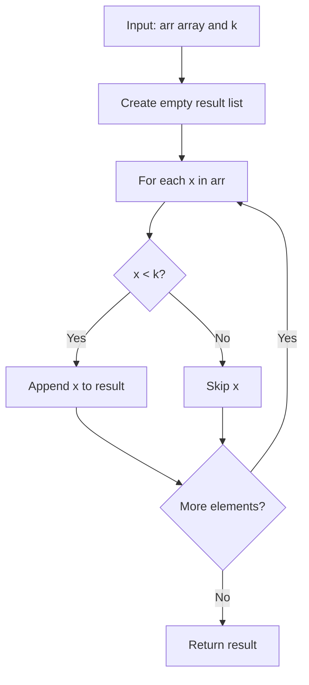

# GFG Elements Less Than K

## Problem

Given an array `arr` and an integer `k`, return a **new** array containing only the elements of `arr` that are **strictly less than `k`**, preserving their original order.

```
result = [x for x in arr if x < k]
```

> Note: This is the same problem as **Get Smaller in Array** (see `Array/Get_Smaller`), just with a different parameter name. The two solutions are identical.

---

## Examples

### Example 1

```
Input:  arr = [1, 2, 3, 4, 5], k = 4
Output: [1, 2, 3]
```

---

### Example 2

```
Input:  arr = [1, 2, 3, 4, 5], k = 1
Output: []
```

---

### Example 3

```
Input:  arr = [10, 20, 30], k = 25
Output: [10, 20]
```

---

## Approach: List Comprehension

### Key Insight

Filtering an array means keeping only the elements that satisfy a condition. In Python, a **list comprehension** is the idiomatic way to build a new list while filtering:

```python
[x for x in arr if x < k]
```

### Algorithm

1. Iterate over every element `x` in `arr`.
2. If `x < k`, include `x` in the result list.
3. Return the new list.

```python
class Solution:
    def elementsLessThanK(self, arr: list[int], k: int) -> list[int]:
        return [x for x in arr if x < k]
```

---

## Complexity Analysis

| | Time | Space |
|--|------|-------|
| **elementsLessThanK** | **O(n)** — one pass over the `n` elements | **O(n)** — the result list holds up to `n` elements |

> Time is optimal: every element must be examined, so Ω(n) work is required.

---

## Flowchart



---

## Example Test Case Trace

**Input:** `arr = [1, 2, 3, 4, 5]`, `k = 4`

| Step | x | x < 4? | result |
|------|---|--------|--------|
| 1 | 1 | Yes | `[1]` |
| 2 | 2 | Yes | `[1, 2]` |
| 3 | 3 | Yes | `[1, 2, 3]` |
| 4 | 4 | No | `[1, 2, 3]` |
| 5 | 5 | No | `[1, 2, 3]` |

**Final result:** `[1, 2, 3]`

---

## Run Tests

From the **repository root**:

```bash
python -m Array.Elements_Less_Than_K.test
```

Expected output:

```
=== GFG: Elements Less Than K ===

PASS: elementsLessThanK([1, 2, 3, 4, 5], 4)
  Expected: [1, 2, 3]
  Got:      [1, 2, 3]
...
```

The `test.py` covers: standard case, empty result, all elements kept, empty array, duplicates, negatives, single element, and boundary values.

---

## Alternative Approaches

| Approach | Time | Space | Notes |
|----------|------|-------|-------|
| List comprehension (this file) | O(n) | O(n) | Idiomatic; one line |
| `filter(lambda x: x < k, arr)` | O(n) | O(n) | Functional style; returns an iterator, needs `list()` |
| Manual `for` loop | O(n) | O(n) | Verbose; equivalent to the comprehension |

---

## Interview Questions

### Q1. Does this modify the input array?

**Answer**: No. The method builds and returns a **new** list; the original `arr` is untouched.

### Q2. What is the difference between `<` and `<=`?

**Answer**: `x < k` keeps elements **strictly** less than `k`. Use `x <= k` to also include elements equal to `k`.

### Q3. How is this related to `Array/Get_Smaller`?

**Answer**: They are the same problem with different parameter names. `elementsLessThanK(arr, k)` and `getSmaller(arr, target)` are functionally identical.

---

## File Structure

```
Array/
└── Elements_Less_Than_K/
    ├── code.py    # Solution.elementsLessThanK using list comprehension
    ├── test.py    # Runnable tests (print-based assertions)
    └── README.md  # Documentation
```