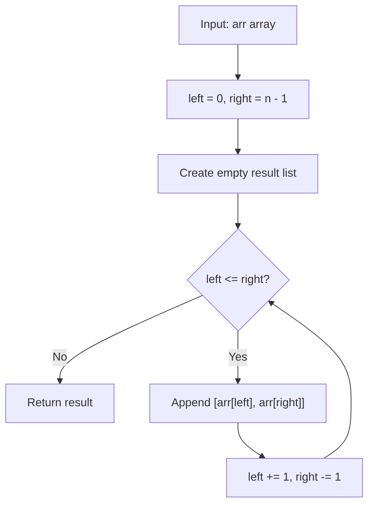

# GFG Array of Pairs

## Problem

Given an array `arr`, build a list of pairs by joining elements from **both ends**, moving inward:

```
arr = [a1, a2, ..., an]  ->  [[a1, an], [a2, a(n-1)], [a3, a(n-2)], ...]
```

- The first pair is `(first, last)`.
- Each subsequent pair takes the next leftmost and next rightmost element.
- When the array has an **odd** length, the middle element is paired with **itself**.

The result is a list of 2-element lists (pairs).

---

## Examples

### Example 1

```
Input:  arr = [1, 2, 3, 4, 5]
Output: [[1, 5], [2, 4], [3, 3]]
```

---

### Example 2

```
Input:  arr = [1, 2, 3, 4]
Output: [[1, 4], [2, 3]]
```

---

### Example 3

```
Input:  arr = [1]
Output: [[1, 1]]
```

---

## Approach: Two Pointers

### Key Insight

The pairs are symmetric about the center of the array: the `i`-th pair always contains `arr[i]` (from the left) and `arr[n-1-i]` (from the right). A **two-pointer** approach walks a `left` pointer forward and a `right` pointer backward simultaneously, building one pair per step.

### Algorithm

1. Initialize `left = 0`, `right = len(arr) - 1`, and an empty `result` list.
2. While `left <= right`:
   - Append `[arr[left], arr[right]]` to `result`.
   - Increment `left`, decrement `right`.
3. Return `result`.

```python
class Solution:
    def arrayOfPairs(self, arr: list[int]) -> list[list[int]]:
        left = 0
        right = len(arr) - 1
        result = []
        while left <= right:
            result.append([arr[left], arr[right]])
            left += 1
            right -= 1
        return result
```

### Why `left <= right` and not `left < right`?

| Condition | When the array has an odd length |
|-----------|----------------------------------|
| `left < right` | Stops before the middle — the middle element is **dropped** |
| `left <= right` | Also pairs the middle element with itself — **no element is lost** |

For even-length arrays the two conditions are equivalent (the loop ends when `left > right`).

---

## Complexity Analysis

| | Time | Space |
|--|------|-------|
| **arrayOfPairs** | **O(n)** — each element is read exactly once | **O(n)** — the result list holds `ceil(n / 2)` pairs |

> Time is optimal: every element must be read, so Ω(n) work is required.

---

## Flowchart



---

## Example Test Case Trace

**Input:** `arr = [1, 2, 3, 4, 5]`

| Step | left | right | Pair | result |
|------|------|-------|------|--------|
| 0 | 0 | 4 | — | `[]` |
| 1 | 0 | 4 | `[1, 5]` | `[[1, 5]]` |
| 2 | 1 | 3 | `[2, 4]` | `[[1, 5], [2, 4]]` |
| 3 | 2 | 2 | `[3, 3]` | `[[1, 5], [2, 4], [3, 3]]` |
| 4 | 3 | 1 | loop ends (`3 > 1`) | `[[1, 5], [2, 4], [3, 3]]` |

**Final result:** `[[1, 5], [2, 4], [3, 3]]`

---

## Run Tests

From the **repository root**:

```bash
python -m Array.GFG_Array_Of_Pairs.test
```

Expected output:

```
=== GFG: Array of Pairs ===

PASS: arrayOfPairs([1, 2, 3, 4, 5])
  Expected: [[1, 5], [2, 4], [3, 3]]
  Got:      [[1, 5], [2, 4], [3, 3]]
...
```

The `test.py` covers: odd length, even length, single element, empty array, two elements, six elements, zeros, negatives, all-equal values, and a seven-element array.

---

## Alternative Approaches

| Approach | Time | Space | Notes |
|----------|------|-------|-------|
| Two pointers (this file) | O(n) | O(n) | Optimal; single pass; no extra copies |
| Index-based comprehension | O(n) | O(n) | `[[arr[i], arr[n-1-i]] for i in range((n+1)//2)]` — concise but less explicit |
| `zip(arr, reversed(arr))` | O(n) | O(n) | `list(zip(arr, reversed(arr)))[: (n+1)//2]` — functional but needs slicing |

---

## Interview Questions

### Q1. Does this modify the input array?

**Answer**: No. The method only reads elements; `arr` is untouched.

### Q2. What happens with an empty array?

**Answer**: `left = 0`, `right = -1`, so `left <= right` is `0 <= -1` — false — and the loop body never runs. The method returns `[]`.

### Q3. Why is the middle element paired with itself for odd-length arrays?

**Answer**: The problem states that every element must be part of a pair. With an odd count there is no distinct partner for the middle element, so pairing it with itself is the only way to include it without leaving it out.

### Q4. How many pairs are produced?

**Answer**: `ceil(n / 2)` pairs — `(n + 1) // 2` in integer arithmetic.

---

## File Structure

```
Array/
└── GFG_Array_Of_Pairs/
    ├── code.py    # Solution.arrayOfPairs using two pointers
    ├── test.py    # Runnable tests (print-based assertions)
    └── README.md  # Documentation
```