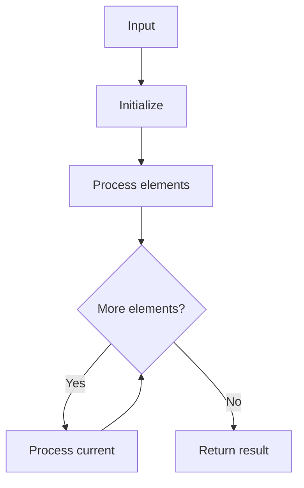

# GFG Array Traversal

## Problem

Given an array `arr`, print all its elements separated by a space.

## Examples

### Example 1

```
Input:  arr = [1, 2, 3]
Output: 1 2 3
```

## Approach

Iterate over the array and print each element with `end=" "`.

## Complexity Analysis

| | Time | Space |
|--|------|-------|
| **arrayTraversal** | **O(n)** | **O(1)** |



## Run Tests

```bash
python -m Array.GFG_Array_Traversal.test
```
