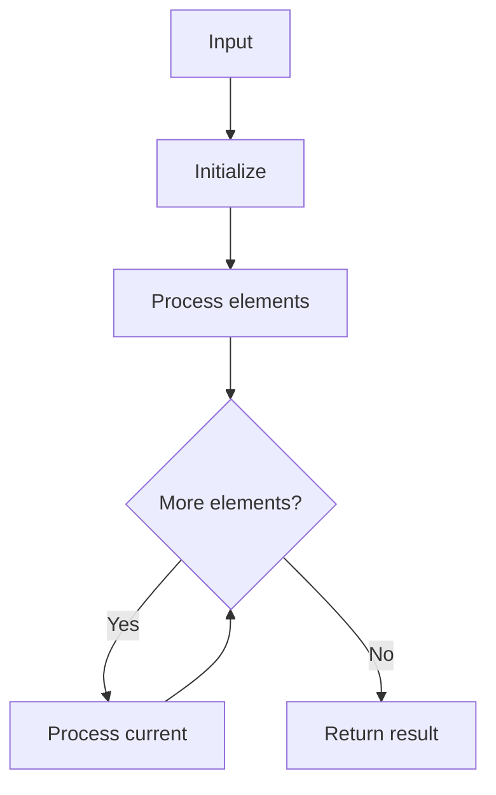

# GFG Ceil in Sorted Array

## Problem

Find index of smallest element >= x in sorted array (ceil). Return -1 if none.

## Approaches

- Binary search: O(log n)
- Naive linear scan: O(n)

## Complexity

Binary: O(log n) time, O(1) space. Naive: O(n) time, O(1) space.



## Run Tests

```bash
python -m Array.GFG_Ceil_in_Sorted_Array.test
```
