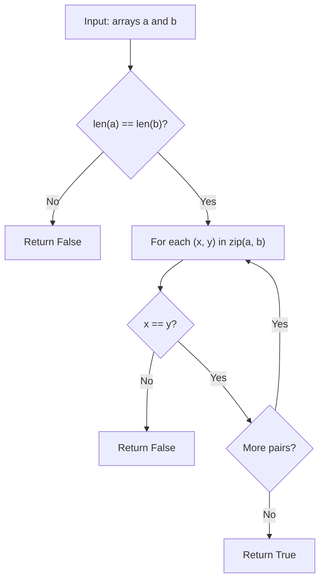

# GFG Check Identical Arrays

## Problem

Given two arrays `a` and `b`, determine whether they are **identical** — i.e., they have the **same length** and the **same elements in the same order**.

```
a = [1, 2, 3], b = [1, 2, 3]  ->  True
a = [1, 2, 3], b = [1, 2, 4]  ->  False
a = [1, 2, 3], b = [1, 2]      ->  False
```

---

## Examples

### Example 1

```
Input:  a = [1, 2, 3, 4, 5], b = [1, 2, 3, 4, 5]
Output: True
```

---

### Example 2

```
Input:  a = [1, 2, 3], b = [1, 2, 4]
Output: False
```

**Explanation:**
```
The last element differs: 3 != 4.
```

---

### Example 3

```
Input:  a = [], b = []
Output: True
```

---

## Approach: Length Check + Element-wise Comparison

### Key Insight

Two arrays are identical only if:

1. They have the **same length** (different lengths → immediately `False`).
2. Every element at the same index is equal: `a[i] == b[i]` for all `i`.

The length check is done first as a fast rejection, then a single pass compares elements pairwise using `zip`.

### Algorithm

1. If `len(a) != len(b)`, return `False`.
2. Iterate over pairs `(x, y)` from `zip(a, b)`:
   - If `x != y`, return `False` immediately (short-circuit).
3. If the loop completes without returning, return `True`.

```python
class Solution:
    def checkIdentical(self, a: list[int], b: list[int]) -> bool:
        if len(a) != len(b):
            return False

        for x, y in zip(a, b):
            if x != y:
                return False
        return True
```

---

## Complexity Analysis

| | Time | Space |
|--|------|-------|
| **checkIdentical** | **O(n)** — at most one pass over the `n` elements | **O(1)** — only the loop variables are used |

> Time is optimal: every element may need to be examined, so Ω(n) work is required. The early-exit on the first mismatch makes the average case even faster.

---

## Flowchart



---

## Example Test Case Trace

**Input:** `a = [1, 2, 3]`, `b = [1, 2, 4]`

| Step | x | y | x == y? | Action |
|------|---|---|---------|--------|
| 1 | 1 | 1 | Yes | continue |
| 2 | 2 | 2 | Yes | continue |
| 3 | 3 | 4 | No | return `False` |

**Final result:** `False`

---

## Run Tests

From the **repository root**:

```bash
python -m Array.GFG_Check_Identical_Arrays.test
```

Expected output:

```
=== GFG: Check Identical Arrays ===

PASS: checkIdentical([1, 2, 3], [1, 2, 3])
  Expected: True
  Got:      True
...
```

The `test.py` covers: identical arrays, differing last element, differing length, both empty, single element (match and mismatch), all-equal values, full match, reversed order (not identical), negatives, zeros, and a near-match.

---

## Alternative Approaches

| Approach | Time | Space | Notes |
|----------|------|-------|-------|
| Length check + element-wise (this file) | O(n) | O(1) | Optimal; short-circuits on first mismatch |
| `a == b` | O(n) | O(1) | Python's built-in list equality; simplest and fastest in practice |
| `all(x == y for x, y in zip(a, b)) and len(a) == len(b)` | O(n) | O(1) | Functional one-liner; same complexity |

---

## Interview Questions

### Q1. Does this modify the input arrays?

**Answer**: No. The method only reads elements; both `a` and `b` are untouched.

### Q2. Why check lengths first?

**Answer**: Different lengths guarantee the arrays are not identical, so we can return `False` immediately without iterating. This is a cheap O(1) fast-reject.

### Q3. What does `zip` do if the lengths differ?

**Answer**: `zip` stops at the shorter array, so without the length check the method could incorrectly return `True` for `[1, 2]` and `[1, 2, 3]`. The length check prevents this.

### Q4. Is there a simpler way in Python?

**Answer**: Yes — `a == b` does exactly the same thing (length check + element-wise comparison) and is the idiomatic Python choice. The explicit loop here shows the mechanics step by step.

---

## File Structure

```
Array/
└── GFG_Check_Identical_Arrays/
    ├── code.py    # Solution.checkIdentical using length check + element-wise comparison
    ├── test.py    # Runnable tests (print-based assertions)
    └── README.md  # Documentation
```