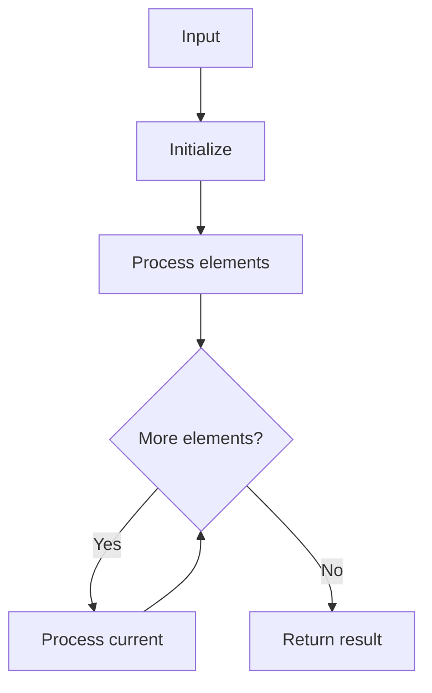

# GFG Count Occurrences in Sorted

## Problem

Count occurrences of target in sorted array.

## Approach

Linear scan counting matches.

## Complexity

O(n) time, O(1) space.



## Run Tests

```bash
python -m Array.GFG_Count_Occurrences_in_Sorted.test
```
