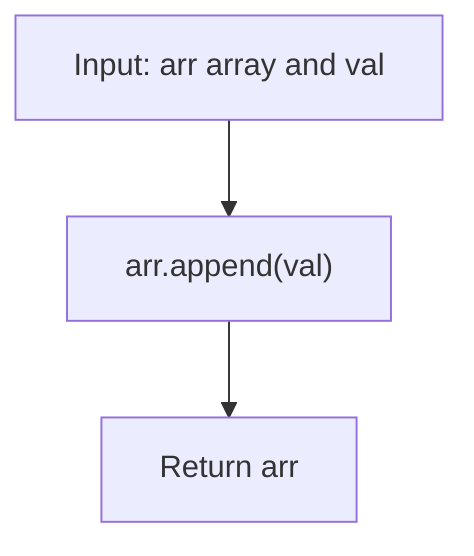

# GFG Insert at End of Array

## Problem

Given an array `arr` and a value `val`, append `val` to the **end** of the array and return the updated array.

```
arr = [a1, a2, ..., an]  ->  [a1, a2, ..., an, val]
```

---

## Examples

### Example 1

```
Input:  arr = [1, 2, 3], val = 4
Output: [1, 2, 3, 4]
```

---

### Example 2

```
Input:  arr = [], val = 1
Output: [1]
```

---

### Example 3

```
Input:  arr = [5], val = 5
Output: [5, 5]
```

---

## Approach: Built-in `append`

### Key Insight

Python lists are dynamic arrays — they grow automatically when an element is added. The `list.append(x)` method does exactly what is needed: it adds `x` to the end of the list **in place** in amortized O(1) time.

### Algorithm

1. Call `arr.append(val)`.
2. Return `arr` (the method also mutates the original list).

```python
class Solution:
    def insertAtEnd(self, arr, val):
        arr.append(val)
        return arr
```

---

## Complexity Analysis

| | Time | Space |
|--|------|-------|
| **insertAtEnd** | **O(1)** amortized — append may occasionally resize the backing store, but the amortized cost per append is constant | **O(1)** — only the new element is stored |

> Appending is one of the cheapest operations on a Python list. Even the rare resize (which copies the existing elements) is amortized to O(1) across many appends.

---

## Flowchart



---

## Example Test Case Trace

**Input:** `arr = [1, 2, 3]`, `val = 4`

| Step | Action | arr |
|------|--------|-----|
| 0 | initial state | `[1, 2, 3]` |
| 1 | `arr.append(4)` | `[1, 2, 3, 4]` |
| 2 | return arr | `[1, 2, 3, 4]` |

---

## Run Tests

From the **repository root**:

```bash
python -m Array.GFG_End_Insert.test
```

Expected output:

```
=== GFG: Insert at End of Array ===

PASS: insertAtEnd([], 1)
  Expected: [1]
  Got:      [1]
...
```

The `test.py` covers: empty array, single element, multi-element array, duplicate values, zeros, negatives, and repeated values.

---

## Alternative Approaches

| Approach | Time | Space | Notes |
|----------|------|-------|-------|
| `arr.append(val)` (this file) | O(1) amortized | O(1) | Optimal; mutates in place |
| `arr + [val]` | O(n) | O(n) | Creates a new list; original unchanged |
| `arr[len(arr):] = [val]` | O(1) amortized | O(1) | Equivalent to append but more verbose |

---

## Interview Questions

### Q1. Does this modify the input array?

**Answer**: Yes. `list.append` mutates the list in place, so `arr` holds the new value after the call and the method returns the same list object.

### Q2. What if I want to keep the original array unchanged?

**Answer**: Use `arr + [val]`, which creates a new list without touching the original.

### Q3. What is the time complexity of `append`?

**Answer**: Amortized O(1). The list occasionally resizes its backing store (doubling in size), which is O(n) for that single call, but the cost is spread over many appends, so the average per-append cost is constant.

---

## File Structure

```
Array/
└── GFG_End_Insert/
    ├── code.py    # Solution.insertAtEnd using list.append
    ├── test.py    # Runnable tests (print-based assertions)
    └── README.md  # Documentation
```