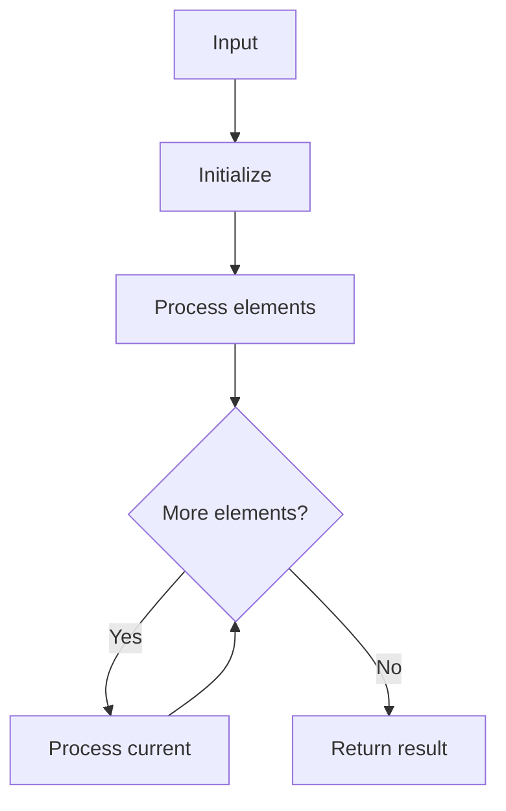

# GFG Insert Interval

## Problem

Insert a new interval into a sorted list of non-overlapping intervals, merging if needed.

## Approach

Three passes: before, merge overlapping, after.

## Complexity

O(n) time, O(n) space.



## Run Tests

```bash
python -m Array.GFG_Insert_Interval.test
```
