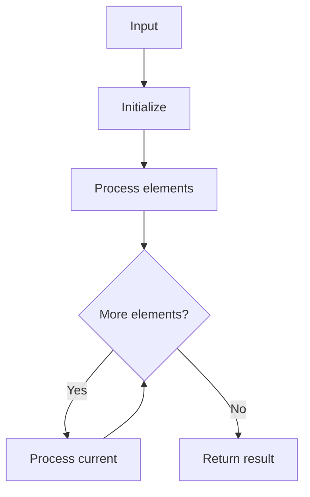

# GFG Kadane's Algorithm

## Problem

Maximum subarray sum.

## Approach

Kadane: maxEnding = max(maxEnding + x, x); track global max.

## Complexity

O(n) time, O(1) space.



## Run Tests

```bash
python -m Array.GFG_Kadanes_Algorithm.test
```
