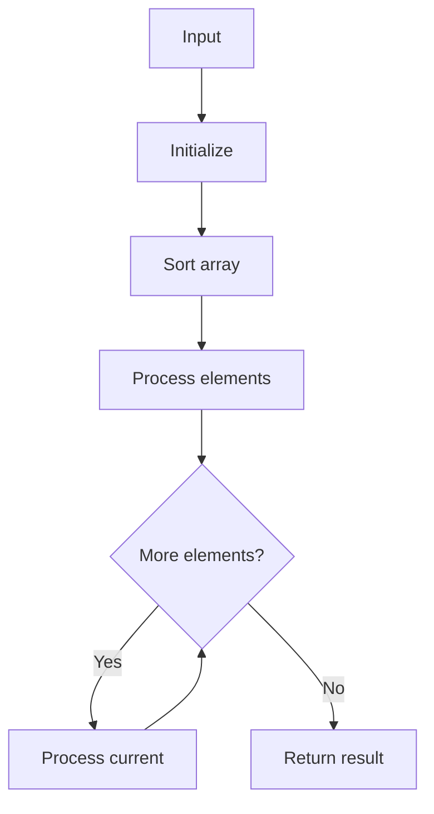

# GFG Merge Without Extra Space

## Problem

Merge two sorted arrays into the first array's size and second, without extra space (here using combined sort).

## Approach

Concatenate, sort, split back.

## Complexity

O((n+m) log(n+m)) time, O(n+m) space (this implementation).



## Run Tests

```bash
python -m Array.GFG_Merge_Without_Extra_Space.test
```
