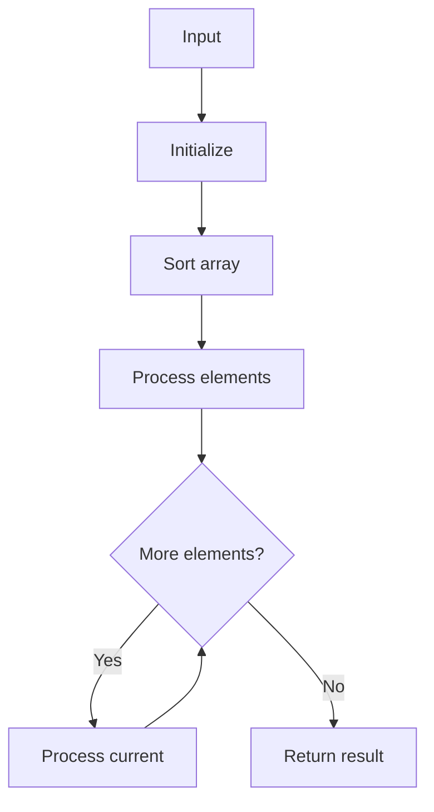

# GFG Minimize the Heights

## Problem

Given array and k, increase/decrease each element by k (no negatives) to minimize (max - min).

## Approach

Sort; try split point i: left +k, right -k; track min/max.

## Complexity

O(n log n) time, O(1) space.



## Run Tests

```bash
python -m Array.GFG_Minimize_the_Heights.test
```
