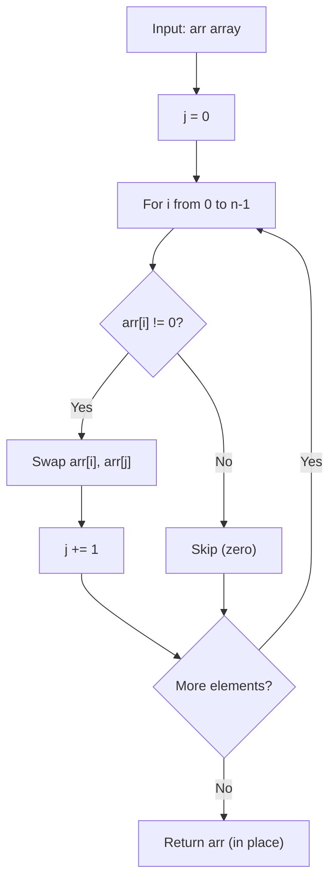

# GFG Move All Zeroes to End

## Problem

Given an array `arr`, **move all 0's to the end** of it while maintaining the **relative order** of the non-zero elements.

The operation must be done **in place** — do not make a copy of the array.

```
arr = [1, 2, 0, 4, 3, 0, 5, 0]  ->  [1, 2, 4, 3, 5, 0, 0, 0]
```

---

## Examples

### Example 1

```
Input:  arr = [1, 2, 0, 4, 3, 0, 5, 0]
Output: [1, 2, 4, 3, 5, 0, 0, 0]
```

**Explanation:**
```
Non-zero elements: [1, 2, 4, 3, 5] keep their relative order.
Zeros: [0, 0, 0] are moved to the end.
```

---

### Example 2

```
Input:  arr = [10, 20, 30]
Output: [10, 20, 30]
```

**Explanation:**
```
No zeros present — the array is unchanged.
```

---

### Example 3

```
Input:  arr = [0, 0]
Output: [0, 0]
```

---

## Approach: Two Pointers (In Place)

### Key Insight

We use two pointers:

- `j` points to the position where the **next non-zero element** should be placed.
- `i` scans the array from left to right.

Whenever `arr[i]` is non-zero, we swap `arr[i]` with `arr[j]` and advance `j`. This moves non-zeros forward while zeros naturally bubble to the end. Since swaps only happen for non-zeros, the relative order of non-zeros is preserved.

### Algorithm

1. Initialize `j = 0`.
2. For `i` from `0` to `n - 1`:
   - If `arr[i] != 0`:
     - Swap `arr[i]` and `arr[j]`.
     - Increment `j`.
3. Return `arr` (already mutated in place).

```python
class Solution:
    def pushZerosToEnd(self, arr: list[int]) -> None:
        j = 0
        for i in range(len(arr)):
            if arr[i] != 0:
                arr[i], arr[j] = arr[j], arr[i]
                j += 1
        return arr
```

### Why this preserves order

| i | arr[i] | Action | arr after |
|---|--------|--------|-----------|
| 0 | 1 | swap arr[0], arr[0] (no-op) | `[1, 2, 0, 4, 3, 0, 5, 0]` |
| 1 | 2 | swap arr[1], arr[1] (no-op) | `[1, 2, 0, 4, 3, 0, 5, 0]` |
| 2 | 0 | skip | `[1, 2, 0, 4, 3, 0, 5, 0]` |
| 3 | 4 | swap arr[3], arr[2] | `[1, 2, 4, 0, 3, 0, 5, 0]` |
| 4 | 3 | swap arr[4], arr[3] | `[1, 2, 4, 3, 0, 0, 5, 0]` |
| 5 | 0 | skip | `[1, 2, 4, 3, 0, 0, 5, 0]` |
| 6 | 5 | swap arr[6], arr[4] | `[1, 2, 4, 3, 5, 0, 0, 0]` |
| 7 | 0 | skip | `[1, 2, 4, 3, 5, 0, 0, 0]` |

Non-zeros are always swapped into the next available slot `j` in their original relative order.

---

## Complexity Analysis

| | Time | Space |
|--|------|-------|
| **pushZerosToEnd** | **O(n)** — single pass over the `n` elements | **O(1)** — only two index variables `i` and `j` |

> Time is optimal: every element must be examined, so Ω(n) work is required. Space is optimal: only two pointers are used.

---

## Flowchart



---

## Example Test Case Trace

**Input:** `arr = [1, 2, 0, 4, 3, 0, 5, 0]`

### Step-by-step

| Step | i | arr[i] | arr[i] != 0? | Swap | j after | arr |
|------|---|--------|---------------|------|---------|-----|
| 0 | 0 | 1 | Yes | arr[0], arr[0] | 1 | `[1, 2, 0, 4, 3, 0, 5, 0]` |
| 1 | 1 | 2 | Yes | arr[1], arr[1] | 2 | `[1, 2, 0, 4, 3, 0, 5, 0]` |
| 2 | 2 | 0 | No | — | 2 | `[1, 2, 0, 4, 3, 0, 5, 0]` |
| 3 | 3 | 4 | Yes | arr[3], arr[2] | 3 | `[1, 2, 4, 0, 3, 0, 5, 0]` |
| 4 | 4 | 3 | Yes | arr[4], arr[3] | 4 | `[1, 2, 4, 3, 0, 0, 5, 0]` |
| 5 | 5 | 0 | No | — | 4 | `[1, 2, 4, 3, 0, 0, 5, 0]` |
| 6 | 6 | 5 | Yes | arr[6], arr[4] | 5 | `[1, 2, 4, 3, 5, 0, 0, 0]` |
| 7 | 7 | 0 | No | — | 5 | `[1, 2, 4, 3, 5, 0, 0, 0]` |

**Final result:** `[1, 2, 4, 3, 5, 0, 0, 0]`

---

## Run Tests

From the **repository root**:

```bash
python -m Array.GFG_Move_All_Zeroes_to_End.test
```

Expected output:

```
=== GFG: Move All Zeroes to End ===

PASS: pushZerosToEnd([1, 2, 0, 4, 3, 0, 5, 0])
  Expected: [1, 2, 4, 3, 5, 0, 0, 0]
  Got:      [1, 2, 4, 3, 5, 0, 0, 0]
...
```

The `test.py` covers: the GFG example, no zeros, all zeros, single element, empty array, scattered zeros, and a 10-element array.

---

## Alternative Approaches

| Approach | Time | Space | Notes |
|----------|------|-------|-------|
| **Two pointers (this file)** | **O(n)** | **O(1)** | Optimal in both time and space |
| Collect non-zeros + append zeros | O(n) | O(n) | Simpler but uses extra list — see `LC_283` |
| Count zeros, shift, fill | O(n) | O(1) | Two passes; equivalent complexity |

### Collect + Append Version (for reference)

```python
class Solution:
    def pushZerosToEnd(self, arr: list[int]) -> None:
        result = [x for x in arr if x != 0]
        result += [0] * (len(arr) - len(result))
        arr[:] = result
```

---

## Interview Questions

### Q1. Does this modify the input array?

**Answer**: Yes. The method mutates `arr` in place via swaps and returns it.

### Q2. Why does the two-pointer approach preserve the relative order of non-zeros?

**Answer**: Non-zeros are only ever swapped into position `j`, which advances monotonically. A non-zero found later is always placed after all previously placed non-zeros, so their relative order is maintained.

### Q3. What happens when there are no zeros?

**Answer**: `j` advances with every element (every `arr[i]` is non-zero, so every swap is a no-op `arr[i], arr[i]`), and the array is unchanged.

### Q4. What happens when all elements are zero?

**Answer**: The `if arr[i] != 0` condition is never true, so `j` stays 0 and no swaps occur. The array remains all zeros.

---

## File Structure

```
Array/
└── GFG_Move_All_Zeroes_to_End/
    ├── code.py    # Solution.pushZerosToEnd using two pointers
    ├── test.py    # Runnable tests (print-based assertions)
    └── README.md  # Documentation
```