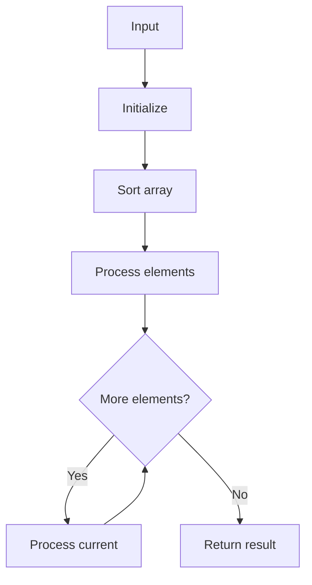

# GFG Non-Overlapping Intervals

## Problem

Minimum number of intervals to remove so remaining are non-overlapping.

## Approach

Sort by end; greedily keep intervals with earliest end.

## Complexity

O(n log n) time, O(1) extra space.



## Run Tests

```bash
python -m Array.GFG_Non_Overlapping_Intervals.test
```
