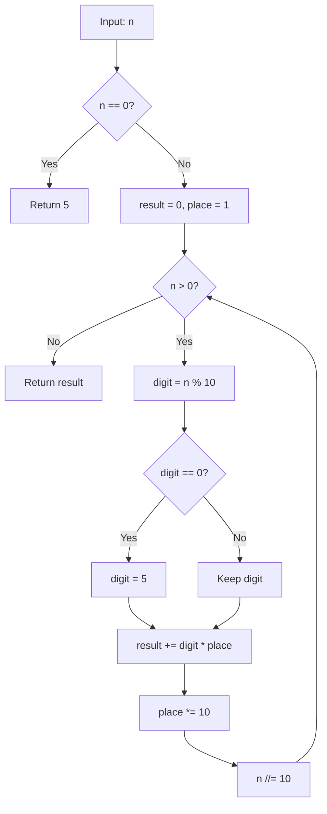

# GFG Replace All 0's With 5

## Problem

Given a number `n`, **replace every 0 digit** in `n` with `5` and return the resulting number.

```
n = 1000  ->  1555
n = 1005  ->  1555
n = 0     ->  5
```

---

## Examples

### Example 1

```
Input:  n = 1000
Output: 1555
```

**Explanation:**
```
1 0 0 0  ->  1 5 5 5
```

---

### Example 2

```
Input:  n = 1005
Output: 1555
```

**Explanation:**
```
1 0 0 5  ->  1 5 5 5
```

---

### Example 3

```
Input:  n = 0
Output: 5
```

---

## Approach: Digit-by-Digit Processing

### Key Insight

A number is just a sequence of digits. We can extract digits one at a time from the **least significant** end using `% 10`, replace any `0` with `5`, and reassemble the number using a running **place value** (`1, 10, 100, …`). Once we've processed every digit, the accumulated value is the answer.

### Algorithm

1. If `n == 0`, return `5` directly (the single digit `0` becomes `5`).
2. Initialize `result = 0` and `place = 1`.
3. While `n > 0`:
   - Extract the last digit: `digit = n % 10`.
   - If `digit == 0`, set `digit = 5`.
   - Add `digit * place` to `result`.
   - Multiply `place` by 10 (move to the next more significant position).
   - Remove the last digit: `n //= 10`.
4. Return `result`.

```python
class Solution:
    def convertFive(self, n):
        if n == 0:
            return 5

        result = 0
        place = 1
        while n > 0:
            digit = n % 10
            if digit == 0:
                digit = 5

            result += digit * place
            place *= 10
            n //= 10
        return result
```

---

## Complexity Analysis

| | Time | Space |
|--|------|-------|
| **convertFive** | **O(d)** — one pass over the `d` digits of `n` | **O(1)** — only `result`, `place`, and `digit` are used |

> `d = floor(log10(n)) + 1`, so the time is effectively O(log n). For a 32-bit integer this is at most 10 iterations.

---

## Flowchart



---

## Example Test Case Trace

**Input:** `n = 1020`

### Step-by-step

| Step | n | digit (n % 10) | after replace | result | place |
|------|---|----------------|---------------|--------|-------|
| 0 | 1020 | — | — | 0 | 1 |
| 1 | 1020 | 0 | 5 | 5 | 10 |
| 2 | 102 | 2 | 2 | 25 | 100 |
| 3 | 10 | 0 | 5 | 525 | 1000 |
| 4 | 1 | 1 | 1 | 1525 | 10000 |
| 5 | 0 | loop ends | — | 1525 | — |

**Final result:** `1525`

---

## Run Tests

From the **repository root**:

```bash
python -m Array.GFG_Replace_0s_With_5.test
```

Expected output:

```
=== GFG: Replace All 0's With 5 ===

PASS: convertFive(0)
  Expected: 5
  Got:      5
...
```

The `test.py` covers: zero itself, single digit, trailing zeros, leading zeros (impossible in integer form but middle zeros), no zeros, all zeros, and a ten-digit number.

---

## Alternative Approaches

| Approach | Time | Space | Notes |
|----------|------|-------|-------|
| Digit-by-digit (this file) | O(d) | O(1) | Optimal; no string conversion |
| String replace | O(d) | O(d) | `int(str(n).replace('0', '5'))` — one line, but allocates a string |
| Recursive | O(d) | O(d) | Recurse on `n // 10`; elegant but uses call stack |

---

## Interview Questions

### Q1. Does this modify the input?

**Answer**: No. The method reads `n` but never mutates it (it works on a local copy via `n //= 10`).

### Q2. What happens when `n = 0`?

**Answer**: The `while n > 0` loop would never execute, returning `0` — wrong. The explicit `if n == 0: return 5` handles this edge case.

### Q3. Why process digits from the right (least significant) end?

**Answer**: Extracting `% 10` gives the last digit, and `// 10` removes it. Processing right-to-left and multiplying by a growing `place` value reassembles the number in the correct order. Processing left-to-right would require knowing the number of digits first.

### Q4. Could we use string manipulation instead?

**Answer**: Yes — `int(str(n).replace('0', '5'))` is a valid one-liner with the same O(d) time, but it allocates an intermediate string. The digit-by-digit approach avoids that allocation.

---

## File Structure

```
Array/
└── GFG_Replace_0s_With_5/
    ├── code.py    # Solution.convertFive using digit-by-digit processing
    ├── test.py    # Runnable tests (print-based assertions)
    └── README.md  # Documentation
```