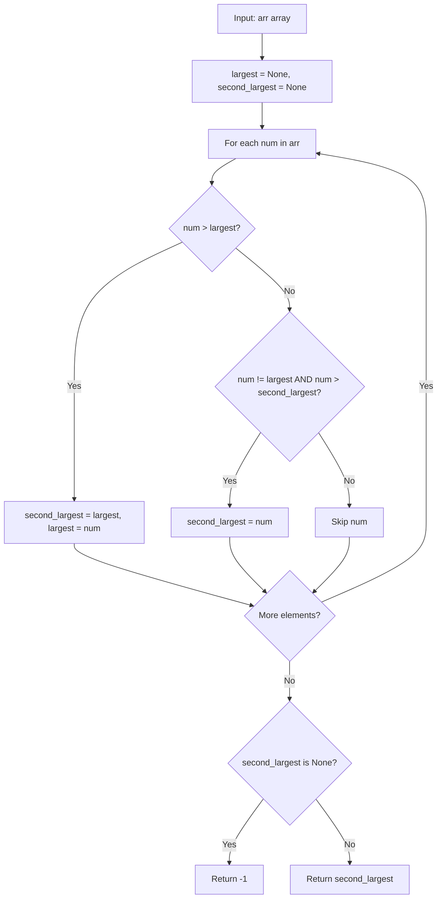

# GFG Second Largest

## Problem

Given an array `arr`, return the **second largest** distinct element in the array. If no second largest exists (fewer than 2 distinct values), return `-1`.

```
arr = [1, 2, 3, 4, 5]  ->  4
arr = [1, 1, 1, 1]     ->  -1
arr = [10, 10, 10, 5]  ->  5
```

---

## Examples

### Example 1

```
Input:  arr = [1, 2, 3, 4, 5]
Output: 4
```

**Explanation:**
```
Largest = 5, second largest = 4.
```

---

### Example 2

```
Input:  arr = [10, 10, 10, 5]
Output: 5
```

**Explanation:**
```
Largest = 10, second largest = 5 (duplicates of 10 are ignored).
```

---

### Example 3

```
Input:  arr = [1, 1, 1, 1]
Output: -1
```

**Explanation:**
```
Only one distinct value exists, so there is no second largest.
```

---

## Approach: Single Pass Tracking

### Key Insight

We can find both the largest and second largest elements in a single pass. We maintain two variables:

- `largest`: the maximum element seen so far.
- `second_largest`: the largest element seen so far that is **strictly less** than `largest`.

For each element `num`:
- If `num > largest`: the old `largest` becomes the new `second_largest`, and `num` becomes `largest`.
- Else if `num` is strictly between `second_largest` and `largest`: update `second_largest`.

Using `None` for initialization (instead of `-1`) correctly handles arrays with negative numbers, since `-1` could be a valid array element.

### Algorithm

1. Initialize `largest = None` and `second_largest = None`.
2. For each `num` in `arr`:
   - If `largest is None` or `num > largest`: set `second_largest = largest`, `largest = num`.
   - Else if `num != largest` and (`second_largest is None` or `num > second_largest`): set `second_largest = num`.
3. Return `second_largest` if it is not `None`, otherwise `-1`.

```python
class Solution:
    def getSecondLargest(self, arr: list[int]) -> int:
        largest = None
        second_largest = None

        for num in arr:
            if largest is None or num > largest:
                second_largest = largest
                largest = num
            elif num != largest and (second_largest is None or num > second_largest):
                second_largest = num

        return second_largest if second_largest is not None else -1
```

---

## Complexity Analysis

| | Time | Space |
|--|------|-------|
| **getSecondLargest** | **O(n)** — one pass over the `n` elements | **O(1)** — only two tracking variables are used |

> Time is optimal: every element must be examined, so Ω(n) work is required.

---

## Flowchart



---

## Example Test Case Trace

**Input:** `arr = [10, 10, 10, 5]`

| Step | num | num > largest? | Action | largest | second_largest |
|------|-----|----------------|--------|---------|----------------|
| 0 | — | — | initial | None | None |
| 1 | 10 | Yes (None) | second=largest, largest=10 | 10 | None |
| 2 | 10 | No | num == largest, skip | 10 | None |
| 3 | 10 | No | num == largest, skip | 10 | None |
| 4 | 5 | No | 5 != 10 and 5 > None, second=5 | 10 | 5 |

**Final result:** `5`

---

## Run Tests

From the **repository root**:

```bash
python -m Array.GFG_Second_Largest.test
```

Expected output:

```
=== GFG: Second Largest ===

PASS: getSecondLargest([1, 2, 3, 4, 5])
  Expected: 4
  Got:      4
...
```

The `test.py` covers: sorted ascending/descending, all duplicates, two elements, duplicates with a smaller value, negatives, zeros, single element, empty array, and repeated values.

---

## Alternative Approaches

| Approach | Time | Space | Notes |
|----------|------|-------|-------|
| Single pass tracking (this file) | O(n) | O(1) | Optimal; one pass; handles negatives |
| Sort and pick `nums[-2]` | O(n log n) | O(n) | Simple but slower; must deduplicate |
| Convert to set, sort | O(n log n) | O(n) | Removes duplicates; more overhead |
| Two passes (max, then max excluding max) | O(n) | O(1) | Two scans; equivalent time |

---

## Interview Questions

### Q1. Does this modify the input array?

**Answer**: No. The method only reads elements; `arr` is untouched.

### Q2. Why initialize with `None` instead of `-1`?

**Answer**: `-1` is a valid array element. If the array is `[-1, -2, -3, -4]`, initializing `largest = -1` would incorrectly treat `-1` as already present. Using `None` avoids this sentinel collision and correctly handles negative numbers.

### Q3. What if all elements are the same?

**Answer**: `second_largest` stays `None`, so the method returns `-1`, indicating no second largest distinct element exists.

### Q4. What about negative numbers?

**Answer**: The algorithm works correctly for negative numbers because `None` initialization doesn't collide with any valid value. The `num != largest` check ensures duplicates don't overwrite `second_largest`.

---

## File Structure

```
Array/
└── GFG_Second_Largest/
    ├── code.py    # Solution.getSecondLargest using single-pass tracking
    ├── test.py    # Runnable tests (print-based assertions)
    └── README.md  # Documentation
```