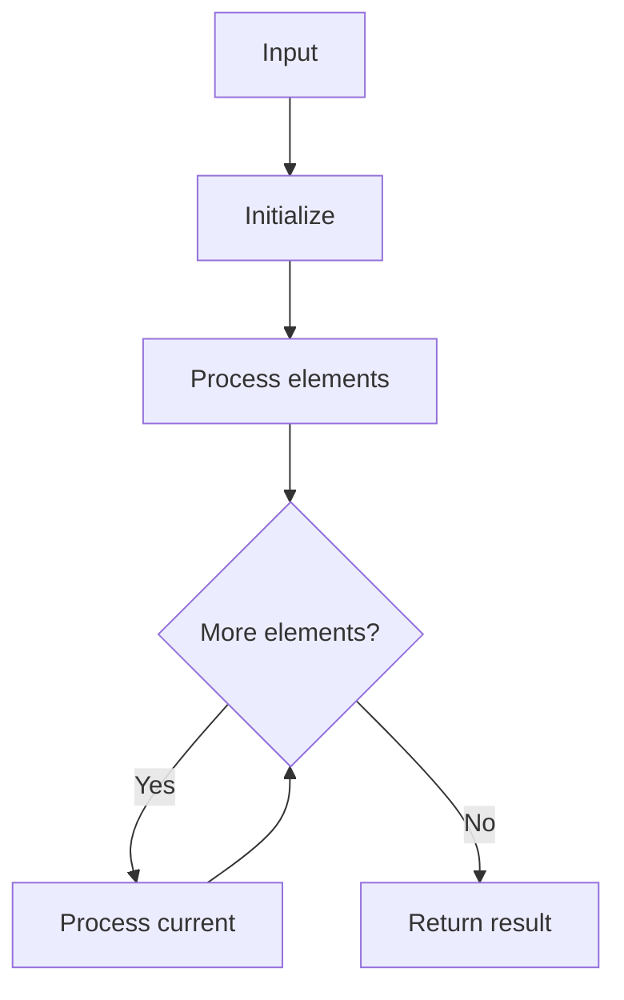

# GFG Smallest Positive Missing

## Problem

Find the smallest positive integer missing from the array.

## Approach

Set lookup; increment from 1 until missing.

## Complexity

O(n) average time, O(n) space.



## Run Tests

```bash
python -m Array.Smallest_Positive_Missing.test
```
