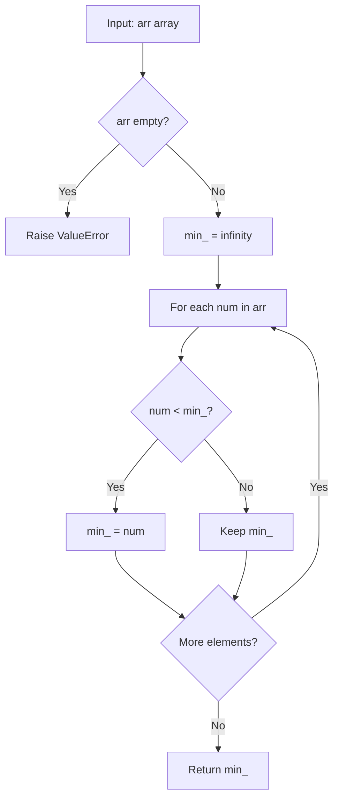

# GFG Smallest in Array

## Problem

Given an array `arr`, return the **smallest** (minimum) element in the array.

```
arr = [a1, a2, ..., an]  ->  min(a1, a2, ..., an)
```

---

## Examples

### Example 1

```
Input:  arr = [1, 2, 3, 4, 5]
Output: 1
```

---

### Example 2

```
Input:  arr = [5, 4, 3, 2, 1]
Output: 1
```

---

### Example 3

```
Input:  arr = [-1, -3, -2, -5, 0]
Output: -5
```

---

## Approach: Linear Scan

### Key Insight

The minimum of an array can be found by scanning every element once. We maintain a running minimum (`min_`), initialized to positive infinity. For each element, if it is smaller than the current `min_`, we update `min_`. After processing all elements, `min_` holds the answer.

### Algorithm

1. If the array is empty, raise an error (no minimum exists).
2. Initialize `min_ = infinity`.
3. For each `num` in `arr`:
   - If `num < min_`, set `min_ = num`.
4. Return `min_`.

```python
class Solution:
    def findMin(self, arr: list[int]) -> int:
        if not arr:
            raise ValueError("Array must not be empty")

        min_ = float("inf")

        for num in arr:
            if num < min_:
                min_ = num
        return min_
```

---

## Complexity Analysis

| | Time | Space |
|--|------|-------|
| **findMin** | **O(n)** — one pass over the `n` elements | **O(1)** — only the `min_` variable is used |

> Time is optimal: every element must be examined, so Ω(n) work is required.

---

## Flowchart



---

## Example Test Case Trace

**Input:** `arr = [3, 1, 4, 1, 5]`

| Step | num | num < min_? | min_ |
|------|-----|-------------|------|
| 0 | — | — | ∞ |
| 1 | 3 | Yes | 3 |
| 2 | 1 | Yes | 1 |
| 3 | 4 | No | 1 |
| 4 | 1 | No | 1 |
| 5 | 5 | No | 1 |

**Final result:** `1`

---

## Run Tests

From the **repository root**:

```bash
python -m Array.GFG_Smallest_in_Array.test
```

Expected output:

```
=== GFG: Smallest in Array ===

PASS: findMin([1, 2, 3, 4, 5])
  Expected: 1
  Got:      1
...
```

The `test.py` covers: sorted ascending, sorted descending, duplicates, single element, negatives, zeros, all-equal values, and a 6-element array.

---

## Alternative Approaches

| Approach | Time | Space | Notes |
|----------|------|-------|-------|
| Linear scan (this file) | O(n) | O(1) | Optimal; explicit and readable |
| `min(arr)` | O(n) | O(1) | Python built-in; same complexity; preferred in practice |
| Sort and take first | O(n log n) | O(n) | Unnecessarily slow; sorts the whole array |
| `functools.reduce(min, arr)` | O(n) | O(1) | Functional style; equivalent to the scan |

---

## Interview Questions

### Q1. Does this modify the input array?

**Answer**: No. The method only reads elements; `arr` is untouched.

### Q2. What happens with an empty array?

**Answer**: The method raises a `ValueError` because no minimum exists for an empty array. The problem typically guarantees a non-empty array, but the guard prevents a silent `inf` return.

### Q3. Why not just use `min(arr)`?

**Answer**: `min(arr)` is the idiomatic Python choice and has the same O(n) / O(1) complexity. The explicit loop here is the pedagogical equivalent — it shows the mechanics step by step and is what most interviewers expect as a hand-written solution.

### Q4. Can we do this recursively?

**Answer**: Yes — `findMin(arr) = min(arr[0], findMin(arr[1:]))` with base case `findMin([x]) = x`. But this uses O(n) call-stack space and is slower due to slicing, so the iterative version is preferred.

---

## File Structure

```
Array/
└── GFG_Smallest_in_Array/
    ├── code.py    # Solution.findMin using linear scan
    ├── test.py    # Runnable tests (print-based assertions)
    └── README.md  # Documentation
```