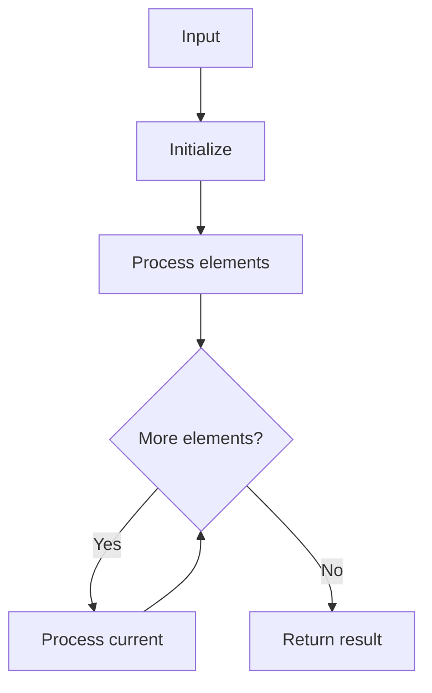

# GFG Stock Buy and Sell – Max One Transaction Allowed

## Problem

Maximize profit with at most one buy and one sell.

## Approach

Track minimum price seen so far; update max profit.

## Complexity

O(n) time, O(1) space.



## Run Tests

```bash
python -m Array.GFG_Stock_Buy_and_Sell_Max_One_Transaction.test
```
