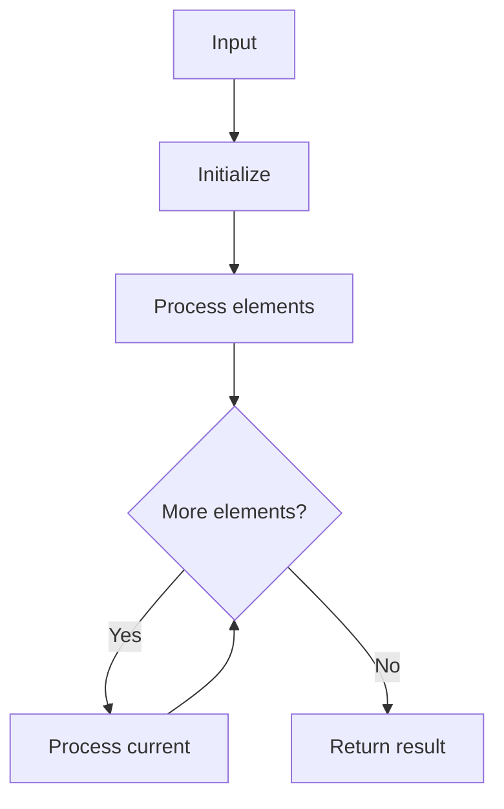

# LC 1011 Capacity To Ship Packages Within D Days

## Problem

Minimum ship capacity to ship all weights within given days.

## Approach

Binary search on capacity; feasibility check counts days needed.

## Complexity

O(n log(sum-max)) time, O(1) space.



## Run Tests

```bash
python -m Array.LC_1011.test
```
