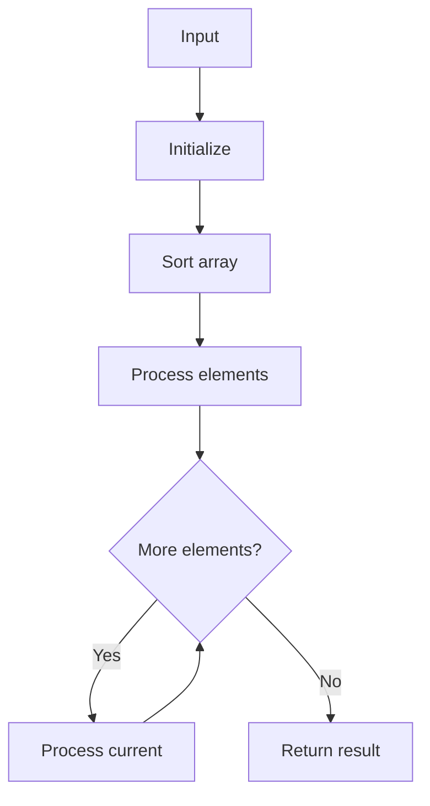

# LC 1288 Remove Covered Intervals

## Problem

Given intervals, remove those covered by another interval; return count of remaining.

## Approach

Sort by start asc, end desc; count intervals with end greater than max_end.

## Complexity

O(n log n) time, O(1) extra space.



## Run Tests

```bash
python -m Array.LC_1288.test
```
