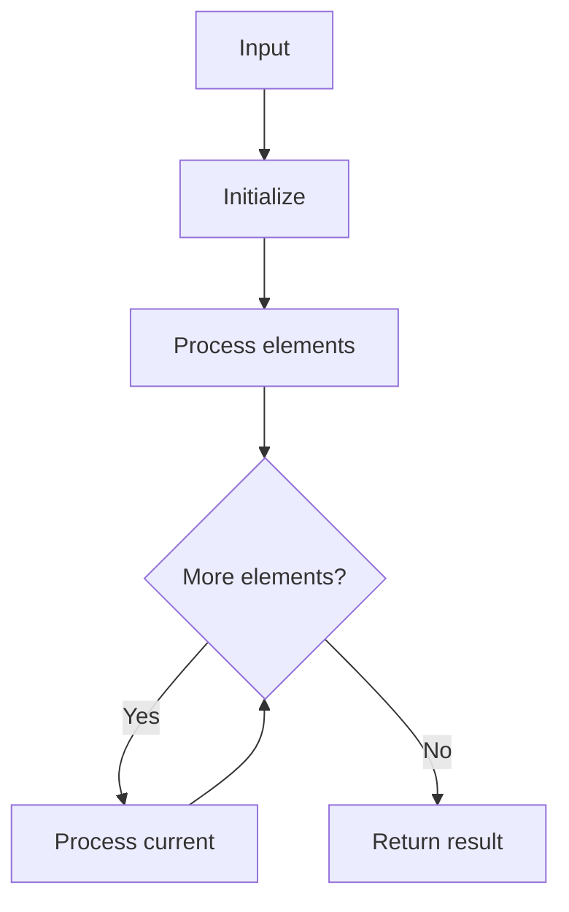

# LC 1470 Shuffle the Array

## Problem

Given array `nums` of length `2n`, shuffle so result is `[nums[0], nums[n], nums[1], nums[n+1], ...]`.

## Approach

Two pointers i (0..n-1) and j (n..2n-1), interleave.

## Complexity

O(n) time, O(n) space.



## Run Tests

```bash
python -m Array.LC_1470.test
```
