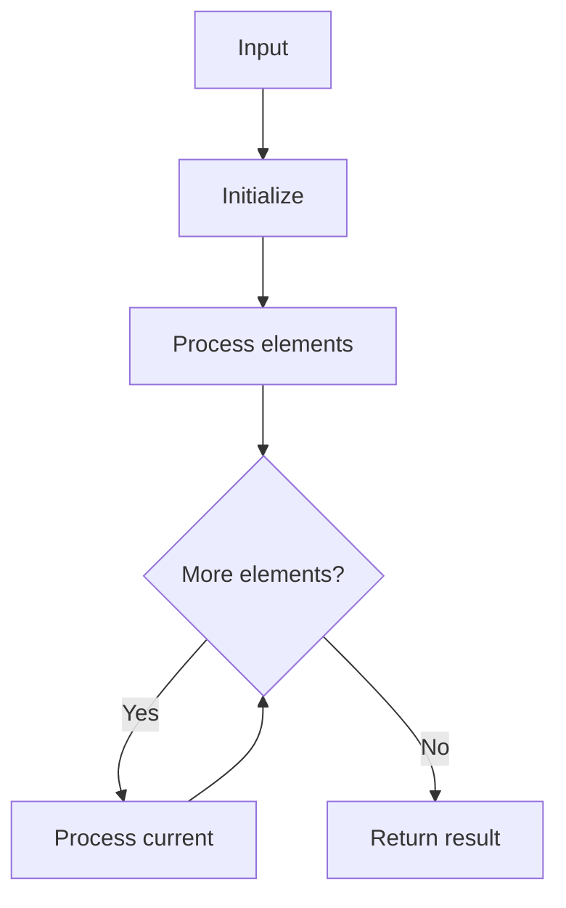

# LC 1480 Running Sum of 1d Array

## Problem

Given an array `nums`, return the running sum where `runningSum[i] = sum(nums[0..i])`.

## Examples

### Example 1

```
Input:  nums = [1, 2, 3, 4]
Output: [1, 3, 6, 10]
```

## Approach

Accumulate sum while iterating.

## Complexity Analysis

| | Time | Space |
|--|------|-------|
| **runningSum** | **O(n)** | **O(n)** |



## Run Tests

```bash
python -m Array.LC_1480.test
```
