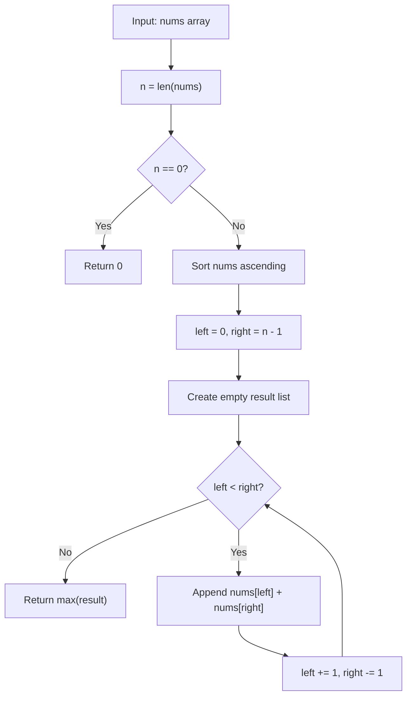

# LC 1877 - Minimize Maximum Pair Sum in Array

## Problem

You are given an integer array `nums` of **even** length. You need to **pair up** the elements into `n / 2` pairs such that:

- Each element is used in **exactly one** pair.
- The **maximum pair sum** is as small as possible.

Return the **minimized maximum pair sum** after optimally pairing the elements.

**Constraints:**

- `2 <= nums.length <= 10^5`
- `nums.length` is even
- `1 <= nums[i] <= 10^5`

---

## Examples

### Example 1

```
Input:  nums = [3, 5, 2, 3]
Output: 7
```

**Explanation:**
```
Optimal pairing: (3, 3) and (5, 2) -> pair sums 6 and 7.
Maximum pair sum = 7.
```

---

### Example 2

```
Input:  nums = [3, 5, 4, 2, 4, 6]
Output: 8
```

**Explanation:**
```
Optimal pairing: (2, 6), (3, 5), (4, 4) -> pair sums 8, 8, 8.
Maximum pair sum = 8.
```

---

### Example 3

```
Input:  nums = [1, 1, 1, 1]
Output: 2
```

**Explanation:**
```
Optimal pairing: (1, 1) and (1, 1) -> pair sums 2 and 2.
Maximum pair sum = 2.
```

---

## Approach: Sort + Greedy Pairing

### Key Insight

To minimize the maximum pair sum, we should **pair the smallest with the largest**. This is a classic greedy strategy:

- If we pair the smallest with the largest, the largest element is "absorbed" by the smallest, preventing it from being paired with another large element (which would create an even larger sum).
- After sorting, the optimal pairs are `(nums[0], nums[n-1])`, `(nums[1], nums[n-2])`, ..., `(nums[n/2 - 1], nums[n/2])`.

The answer is the **maximum** of all these pair sums.

### Algorithm

1. Sort `nums` in ascending order.
2. Initialize two pointers: `left = 0`, `right = n - 1`.
3. While `left < right`:
   - Compute the pair sum `nums[left] + nums[right]`.
   - Append it to a `result` list.
   - Move `left` forward and `right` backward.
4. Return `max(result)`.

```python
class Solution:
    def minPairSum(self, nums: list[int]) -> int:
        n = len(nums)
        if n == 0:
            return 0

        nums.sort()
        result = []
        left = 0
        right = n - 1
        while left < right:
            result.append(nums[left] + nums[right])
            left += 1
            right -= 1
        return max(result) if result else 0
```

---

## Complexity Analysis

| | Time | Space |
|--|------|-------|
| **minPairSum** | **O(n log n)** — dominated by sorting | **O(n)** — the `result` list stores `n / 2` pair sums |

> The two-pointer scan itself is O(n), but sorting dominates. The space could be reduced to O(1) by tracking only the running maximum instead of storing all pair sums.

---

## Flowchart



---

## Example Test Case Trace

**Input:** `nums = [3, 5, 2, 3]`

### Step 1: Sort

`nums = [2, 3, 3, 5]`

### Step 2: Pair and sum

| Step | left | right | nums[left] | nums[right] | pair sum | result |
|------|------|-------|------------|-------------|----------|--------|
| 1 | 0 | 3 | 2 | 5 | 7 | `[7]` |
| 2 | 1 | 2 | 3 | 3 | 6 | `[7, 6]` |

### Step 3: Return max

`max([7, 6]) = 7`

**Final result:** `7`

---

## Run Tests

From the **repository root**:

```bash
python -m Array.LC_1877.test
```

Expected output:

```
=== LC 1877: Minimize Maximum Pair Sum in Array ===

PASS: minPairSum([3, 5, 2, 3])
  Expected: 7
  Got:      7
...
```

The `test.py` covers: both LeetCode examples, all-equal values, two elements, sequential arrays, negatives, zeros, and extreme values.

---

## Alternative Approaches

| Approach | Time | Space | Notes |
|----------|------|-------|-------|
| Sort + two pointers (this file) | O(n log n) | O(n) | Optimal; sort dominates |
| Sort + running max | O(n log n) | O(1) | Same time; avoids storing all pair sums |
| Brute force (try all pairings) | O((n-1)!!) | O(n) | Exponentially slow; infeasible for large n |

---

## Interview Questions

### Q1. Why pair smallest with largest?

**Answer**: Pairing the smallest with the largest prevents the largest element from being paired with another large element, which would create an even larger sum. This greedy choice minimizes the maximum pair sum.

### Q2. Does this modify the input array?

**Answer**: Yes. `nums.sort()` sorts in place. If the original order must be preserved, sort a copy: `sorted(nums)`.

### Q3. Can we reduce the space to O(1)?

**Answer**: Yes. Instead of storing all pair sums in a list, track only the running maximum:

```python
ans = 0
left, right = 0, n - 1
while left < right:
    ans = max(ans, nums[left] + nums[right])
    left += 1
    right -= 1
return ans
```

### Q4. What if the array length is odd?

**Answer**: The problem guarantees even length. If it weren't, one element would be left unpaired, and the problem definition would need clarification.

---

## File Structure

```
Array/
└── LC_1877/
    ├── code.py    # Solution.minPairSum using sort + two pointers
    ├── test.py    # Runnable tests (print-based assertions)
    └── README.md  # Documentation
```