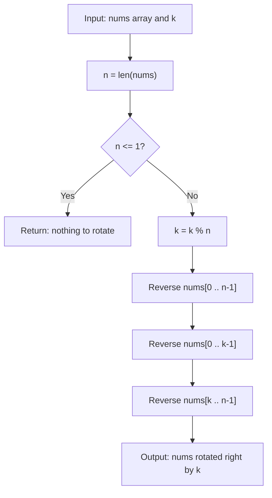

# LC 189 - Rotate Array

## Problem

Given an integer array `nums` and an integer `k`, **rotate the array to the right by `k` steps**.

A right rotation by `k` moves the last `k` elements to the front, keeping their relative order, and shifts the remaining elements to the right:

```
nums = [a1, a2, ..., an]  ->  [a(n-k+1), ..., an, a1, a2, ..., a(n-k)]
```

The rotation is performed **in place**, so `rotate` mutates `nums` and returns `None`.

**Constraints:**

- `1 <= nums.length <= 2000`
- `-100 <= nums[i] <= 100`
- `0 <= k <= 2000`

---

## Examples

### Example 1

```
Input:  nums = [1, 2, 3, 4, 5, 6, 7], k = 3
Output: [5, 6, 7, 1, 2, 3, 4]
```

**Explanation:**
```
The last 3 elements (5, 6, 7) wrap around to the front.
```

---

### Example 2

```
Input:  nums = [-1, -100, 3, 99], k = 2
Output: [3, 99, -1, -100]
```

---

### Example 3

```
Input:  nums = [1, 2, 3], k = 3
Output: [1, 2, 3]
```

**Explanation:**
```
k = 3 equals the length of the array, so a full rotation returns the original order.
```

---

## Approach: Three Reversals

### Key Insight

Reversing the array puts the elements in **descending** order, so the last `k` elements — the ones that must move to the front — end up **at the beginning** in reverse order. Two more targeted reversals put them back in the correct order:

1. Reverse the **whole** array → the last `k` elements are now at the front, but reversed.
2. Reverse the **first `k`** elements → those `k` elements are now in their original relative order.
3. Reverse the **remaining `n - k`** elements → the rest of the array returns to its original order.

Net effect: the last `k` elements sit at the front in order, and everything else follows — exactly a right rotation by `k`.

### Algorithm

1. If the array has `0` or `1` element, there is nothing to rotate — return.
2. Normalize `k = k % n` (rotating by `n` steps is a no-op, so `k` may exceed the array length).
3. Reverse `nums[0 .. n-1]`.
4. Reverse `nums[0 .. k-1]`.
5. Reverse `nums[k .. n-1]`.

```python
class Solution:
    def rotate(self, nums: list[int], k: int) -> None:
        n = len(nums)

        if n <= 1:
            return

        k = k % n

        def reverse_range(left: int, right: int) -> None:
            while left < right:
                nums[left], nums[right] = nums[right], nums[left]
                left += 1
                right -= 1

        reverse_range(0, n - 1)
        reverse_range(0, k - 1)
        reverse_range(k, n - 1)
```

> `k = k % n` also handles `k = 0`: the first reversal flips the whole array and the third reversal flips it back, so the array is unchanged.

---

## Complexity Analysis

| | Time | Space |
|--|------|-------|
| **rotate** | **O(n)** — three reversals touch each element a constant number of times | **O(1)** — the rotation is in place; only two pointers are used |

> Time is optimal: Ω(n) elements must be moved, so no in-place solution can beat O(n).

---

## Flowchart



---

## Example Test Case Trace

**Input:** `nums = [1, 2, 3, 4, 5, 6, 7]`, `k = 3` → `k = 3 % 7 = 3`

### Step-by-step

| Step | Action | nums |
|------|--------|------|
| 0 | initial state | `[1, 2, 3, 4, 5, 6, 7]` |
| 1 | `reverse_range(0, 6)` | `[7, 6, 5, 4, 3, 2, 1]` |
| 2 | `reverse_range(0, 2)` | `[5, 6, 7, 4, 3, 2, 1]` |
| 3 | `reverse_range(3, 6)` | `[5, 6, 7, 1, 2, 3, 4]` |

### Final result

```
nums = [5, 6, 7, 1, 2, 3, 4]
```

---

## Run Tests

From the **repository root**:

```bash
python -m Array.LC_189.test
```

Expected output:

```
=== LC 189: Rotate Array ===

PASS: rotate([1, 2, 3, 4, 5, 6, 7], 3)
  Expected: [5, 6, 7, 1, 2, 3, 4]
  Got:      [5, 6, 7, 1, 2, 3, 4]
...
```

The `test.py` covers: the two LeetCode examples, `k = 0`, `k = n`, `k > n`, a single-element array, an empty array, duplicated values, negative numbers, and `k = 1`.

---

## Alternative Approaches

| Approach | Time | Space | Notes |
|----------|------|-------|-------|
| **Three reversals** (this file) | **O(n)** | **O(1)** | Optimal in place; no extra allocation |
| `nums[:] = nums[-k:] + nums[:-k]` | O(n) | O(n) | One line; allocates a new list |
| Cyclic replacement | O(n) | O(n) | Uses `nums[(i + k) % n]`; needs a visited marker |
| Extra buffer | O(n) | O(n) | Copy into a second array, then back |
| Rotate by one, `k` times | O(n·k) | O(1) | Too slow — see `Array/Rotate_Array_By_One` |

---

## Interview Questions

### Q1. Does this modify the input array?

**Answer**: Yes. The rotation happens **in place** — `nums` holds the rotated values after the call and the method returns `None`. If the original order must be kept, pass a copy: `nums = list(nums)`.

### Q2. Why is `k = k % n` needed?

**Answer**: Rotating by `n` positions returns the array to its original order, so only `k % n` matters. It also keeps the reversal ranges valid when `k > n` (e.g. `k = 2000` on a 7-element array becomes `k = 5`).

### Q3. What happens when `k = 0`?

**Answer**: The whole array is reversed, then the first `0` elements are reversed (a no-op), then the whole array is reversed again — the two full reversals cancel out and the array is unchanged.

### Q4. Why three reversals instead of slicing?

**Answer**: Slicing (`nums[-k:] + nums[:-k]`) is simpler but allocates a second list, making it **O(n) space**. The reversal trick achieves the same result with **O(1) extra space**, which matters when the array is large or memory is constrained.

### Q5. How is this related to `Array/Rotate_Array_By_One`?

**Answer**: Rotating by one is just the `k = 1` case of this problem. That folder shifts elements one position to the right with a single backward pass, while this generalises to any `k` using reversals.

---

## File Structure

```
Array/
└── LC_189/
    ├── code.py    # Solution.rotate - rotate right by k using three reversals
    ├── test.py    # Runnable tests (print-based assertions)
    └── README.md  # Documentation
```
