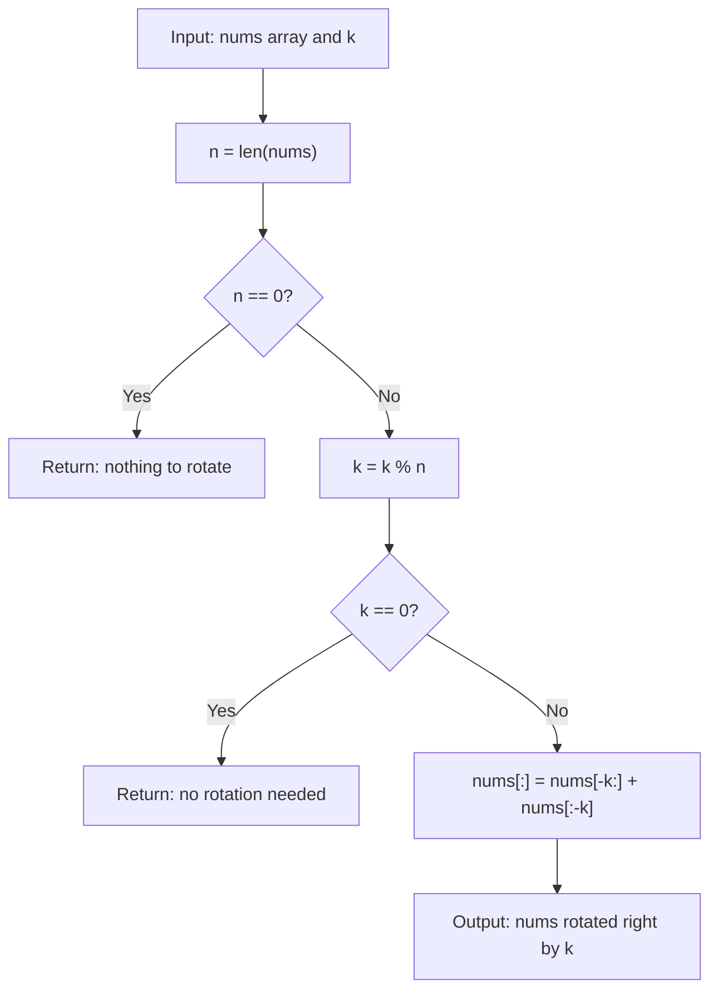

# LC 189 - Rotate Array (Slicing Approach)

## Problem

Given an integer array `nums` and an integer `k`, **rotate the array to the right by `k` steps**.

A right rotation by `k` moves the last `k` elements to the front, keeping their relative order, and shifts the remaining elements to the right:

```
nums = [a1, a2, ..., an]  ->  [a(n-k+1), ..., an, a1, a2, ..., a(n-k)]
```

The rotation is performed **in place**, so `rotate` mutates `nums` and returns `None`.

**Constraints:**

- `1 <= nums.length <= 10^5`
- `-2^31 <= nums[i] <= 2^31 - 1`
- `0 <= k <= 10^5`

---

## Examples

### Example 1

```
Input:  nums = [1, 2, 3, 4, 5, 6, 7], k = 3
Output: [5, 6, 7, 1, 2, 3, 4]
```

**Explanation:**
```
The last 3 elements (5, 6, 7) wrap around to the front.
```

---

### Example 2

```
Input:  nums = [-1, -100, 3, 99], k = 2
Output: [3, 99, -1, -100]
```

---

### Example 3

```
Input:  nums = [1, 2, 3], k = 3
Output: [1, 2, 3]
```

**Explanation:**
```
k = 3 equals the length of the array, so a full rotation returns the original order.
```

---

## Approach: Slicing

### Key Insight

Python list slicing makes this a one-liner conceptually:

- `nums[-k:]` gives the last `k` elements (the ones that move to the front).
- `nums[:-k]` gives the first `n - k` elements (the ones that shift right).
- Concatenating them — `nums[-k:] + nums[:-k]` — produces the rotated array.

To keep it **in place**, we use slice assignment: `nums[:] = ...`, which overwrites the contents of the existing list without creating a new reference.

### Algorithm

1. If the array is empty, return.
2. Normalize `k = k % n` (rotating by `n` steps is a no-op).
3. If `k == 0`, return (nothing to do).
4. Assign `nums[:] = nums[-k:] + nums[:-k]`.

```python
class Solution:
    def rotate(self, nums: list[int], k: int) -> None:
        n = len(nums)

        if n == 0:
            return

        k = k % n

        if k == 0:
            return

        nums[:] = nums[-k:] + nums[:-k]
```

---

## Complexity Analysis

| | Time | Space |
|--|------|-------|
| **rotate** | **O(n)** — slicing creates two sub-lists and concatenates them | **O(n)** — the sliced sub-lists and the concatenated result use extra memory |

> Time is optimal: Ω(n) elements must be moved. Space is **not** optimal — unlike the three-reversal approach (O(1) space), slicing allocates O(n) extra memory. The trade-off is simplicity: one line of logic vs. three reversal passes.

---

## Flowchart



---

## Example Test Case Trace

**Input:** `nums = [1, 2, 3, 4, 5, 6, 7]`, `k = 3` → `k = 3 % 7 = 3`

### Step-by-step

| Step | Action | Result |
|------|--------|--------|
| 1 | `nums[-k:]` → last 3 elements | `[5, 6, 7]` |
| 2 | `nums[:-k]` → first 4 elements | `[1, 2, 3, 4]` |
| 3 | Concatenate: `[5, 6, 7] + [1, 2, 3, 4]` | `[5, 6, 7, 1, 2, 3, 4]` |
| 4 | `nums[:] = ...` → write back in place | `[5, 6, 7, 1, 2, 3, 4]` |

**Final result:** `[5, 6, 7, 1, 2, 3, 4]`

---

## Run Tests

From the **repository root**:

```bash
python -m Array.LC_189.Slicing.test
```

Expected output:

```
=== LC 189: Rotate Array (Slicing) ===

PASS: rotate([1, 2, 3, 4, 5, 6, 7], 3)
  Expected: [5, 6, 7, 1, 2, 3, 4]
  Got:      [5, 6, 7, 1, 2, 3, 4]
...
```

The `test.py` covers: the two LeetCode examples, `k = 0`, `k = n`, `k > n`, single element, empty array, duplicated values, and `k = 1`.

---

## Alternative Approaches

| Approach | Time | Space | Notes |
|----------|------|-------|-------|
| **Slicing (this file)** | **O(n)** | **O(n)** | Simplest; one line of logic |
| Three reversals | O(n) | O(1) | Optimal space; see `Array/LC_189/Three_Reversals` |
| Cyclic replacement | O(n) | O(n) | Uses `nums[(i + k) % n]`; needs a visited marker |
| Extra buffer | O(n) | O(n) | Copy into a second array, then back |
| Rotate by one, `k` times | O(n·k) | O(1) | Too slow |

---

## Interview Questions

### Q1. Does this modify the input array?

**Answer**: Yes. `nums[:] = ...` mutates the existing list in place, so the caller sees the change. Using `nums = nums[-k:] + nums[:-k]` instead would rebind the local variable and leave the caller's list unchanged.

### Q2. Why is `k = k % n` needed?

**Answer**: Rotating by `n` positions returns the array to its original order, so only `k % n` matters. It also keeps the slice indices valid when `k > n`.

### Q3. Why the `k == 0` early return?

**Answer**: When `k == 0`, `nums[-0:]` is `nums[0:]` (the whole array) and `nums[:-0]` is `nums[:0]` (empty), so the concatenation would be `nums + []` = `nums` — correct but wasteful. The early return avoids the unnecessary allocation.

### Q4. Slicing vs. Three Reversals — which to use?

**Answer**: Slicing is more readable and less error-prone. Three reversals use O(1) extra space, which matters for very large arrays or memory-constrained environments. In practice, Python's C-optimized slicing is often faster despite the extra memory.

### Q5. How is this related to `Array/LC_189/Three_Reversals`?

**Answer**: Both solve the same problem. The slicing approach trades O(n) space for simplicity, while the three-reversal approach achieves O(1) space with more code. They produce identical results.

---

## File Structure

```
Array/
└── LC_189/
    └── Slicing/
        ├── code.py    # Solution.rotate using list slicing
        ├── test.py    # Runnable tests (print-based assertions)
        └── README.md  # Documentation
```