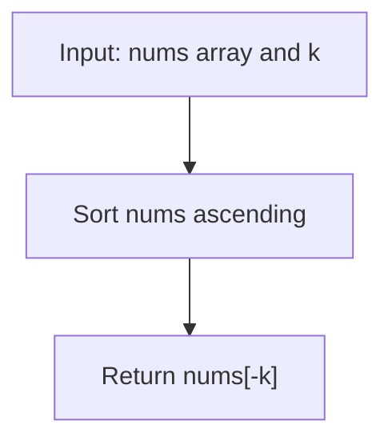

# LC 215 - Kth Largest Element in an Array

## Problem

Given an integer array `nums` and an integer `k`, return the **k-th largest** element in the array.

Note that it is the k-th largest element in the **sorted order**, not the k-th distinct element.

**Constraints:**

- `1 <= k <= nums.length <= 10^5`
- `-10^4 <= nums[i] <= 10^4`

---

## Examples

### Example 1

```
Input:  nums = [3, 2, 1, 5, 6, 4], k = 2
Output: 5
```

**Explanation:**
```
Sorted: [1, 2, 3, 4, 5, 6]
The 2nd largest element is 5 (at index 4 from the start, or index -2 from the end).
```

---

### Example 2

```
Input:  nums = [3, 2, 3, 1, 2, 4, 5, 5, 6], k = 4
Output: 4
```

**Explanation:**
```
Sorted: [1, 2, 2, 3, 3, 4, 5, 5, 6]
The 4th largest element is 4.
```

---

## Approach: Sort and Index

### Key Insight

After sorting the array in ascending order, the largest element is at the last index `n - 1`, the 2nd largest at `n - 2`, and so on. Therefore, the k-th largest element is at index `-(k)` from the end, i.e. `nums[-k]`.

### Algorithm

1. Sort `nums` in ascending order (in place).
2. Return `nums[-k]`.

```python
class Solution:
    def findKthLargest(self, nums: list[int], k: int) -> int:
        nums.sort()
        return nums[-k]
```

### Why `nums[-k]`?

| k | Meaning | Index |
|---|---------|-------|
| 1 | largest | `nums[-1]` |
| 2 | 2nd largest | `nums[-2]` |
| k | k-th largest | `nums[-k]` |

---

## Complexity Analysis

| | Time | Space |
|--|------|-------|
| **findKthLargest** | **O(n log n)** — Timsort on `n` elements (worst, average, and best) | **O(n)** — Timsort requires temporary working space; sorts in-place w.r.t. the input array but uses extra memory internally |

> While this is clean and easy to write, it does more work than necessary: we only need one element, not a fully sorted array. A **Quickselect**-based solution achieves **average O(n)** time, and a **min-heap of size k** achieves **O(n log k)**. Sorting is O(n log n) but is often fast enough in practice thanks to Timsort's optimizations.

---

## Flowchart



---

## Example Test Case Trace

**Input:** `nums = [3, 2, 1, 5, 6, 4]`, `k = 2`

### Step 1: Sort

`nums = [1, 2, 3, 4, 5, 6]`

### Step 2: Index

`nums[-2] = nums[4] = 5`

**Final result:** `5`

---

## Run Tests

From the **repository root**:

```bash
python -m Array.LC_215.test
```

Expected output:

```
=== LC 215: Kth Largest Element in an Array ===

PASS: findKthLargest([3, 2, 1, 5, 6, 4], 2)
  Expected: 5
  Got:      5
...
```

The `test.py` covers: both LeetCode examples, single element, two elements, all-equal values, negatives, descending order, and boundary k values.

---

## Alternative Approaches

| Approach | Time | Space | Notes |
|----------|------|-------|-------|
| Sort + index (this file) | O(n log n) | O(n) | Simplest; uses Timsort |
| Min-heap of size k | O(n log k) | O(k) | Good when k is small |
| Max-heap, extract k-1 | O(n + k log n) | O(1) | See `Heaps/LC_215` |
| **Quickselect** | **O(n) avg** (O(n²) worst) | O(1) | Fastest average; no full sort |

> For small `k` relative to `n`, the min-heap approach is more efficient since it avoids sorting the entire array.

---

## Interview Questions

### Q1. Does this approach modify the input array?

**Answer**: Yes. `nums.sort()` sorts the list **in-place**, so the original order of `nums` is lost after the call. If you need to preserve it, pass a copy: `sorted(nums)[-k]`.

### Q2. What is `list.sort()` vs `sorted()`?

**Answer**: `list.sort()` sorts in-place and returns `None`. `sorted(iterable)` returns a new sorted list without modifying the original. Both use Timsort (O(n log n)).

### Q3. Why not use Quickselect here?

**Answer**: You can, and it's faster on average (O(n)). But the sort-based method is shorter, less error-prone, and Timsort is highly optimized in C, so for moderate inputs it's often just as fast in practice while being far simpler to write and verify.

### Q4. What if k is larger than the array length?

**Answer**: The problem guarantees `1 <= k <= nums.length`, so this never happens. If it did, `nums[-k]` would raise an `IndexError`.

---

## File Structure

```
Array/
└── LC_215/
    ├── code.py    # findKthLargest using list.sort()
    ├── test.py    # Unit tests (print-based assertions)
    └── README.md  # Documentation
```