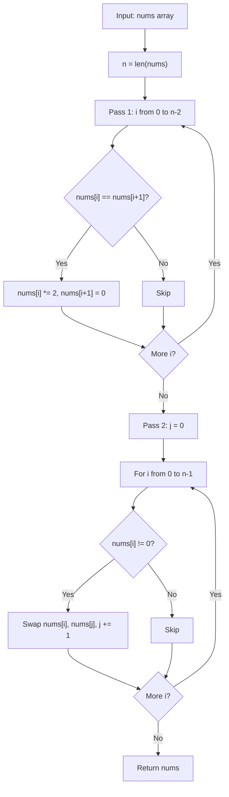

# LC 2460 - Apply Operations to an Array

## Problem

You are given a **0-indexed** array `nums` of size `n` consisting of non-negative integers.

You need to apply `n - 1` **operations** to this array where, in the `i`-th operation (0-indexed), you will apply the following on the `i`-th element of `nums`:

- If `nums[i] == nums[i + 1]`, then multiply `nums[i]` by `2` and set `nums[i + 1]` to `0`. Otherwise, you skip this operation.

After performing all the operations, **shift all the 0's to the end** of the array while maintaining the relative order of the non-zero elements.

Return the resulting array.

**Note:** The operations are applied **sequentially**, starting from `i = 0` up to `i = n - 2`.

**Constraints:**

- `2 <= nums.length <= 2000`
- `0 <= nums[i] <= 1000`

---

## Examples

### Example 1

```
Input:  nums = [1, 2, 2, 1, 1, 0]
Output: [1, 4, 2, 0, 0, 0]
```

**Explanation:**
```
i=0: nums[0] != nums[1] (1 != 2), skip.
i=1: nums[1] == nums[2] (2 == 2), nums[1] = 4, nums[2] = 0 -> [1, 4, 0, 1, 1, 0]
i=2: nums[2] != nums[3] (0 != 1), skip.
i=3: nums[3] == nums[4] (1 == 1), nums[3] = 2, nums[4] = 0 -> [1, 4, 0, 2, 0, 0]
i=4: nums[4] != nums[5] (0 != 0)... wait, 0 == 0! nums[4] = 0, nums[5] = 0 -> [1, 4, 0, 2, 0, 0]
Shift zeros to end: [1, 4, 2, 0, 0, 0]
```

---

### Example 2

```
Input:  nums = [0, 1]
Output: [1, 0]
```

**Explanation:**
```
i=0: nums[0] != nums[1] (0 != 1), skip.
Shift zeros to end: [1, 0]
```

---

## Approach: Two-Pass (Operations + Zero Shift)

### Key Insight

The problem has two distinct phases:

1. **Operations pass**: iterate left to right, merging equal adjacent pairs. The operation is applied **sequentially** — once `nums[i]` is modified, the next comparison uses the updated value. This means a chain like `[2, 2, 2]` becomes `[4, 0, 2]` (not `[4, 4, 0]`), because after merging indices 0 and 1, index 1 is now 0, so index 2's value 2 doesn't match.

2. **Zero-shift pass**: move all zeros to the end using the two-pointer technique (same as `Move_All_Zeroes_to_End`), preserving the relative order of non-zeros.

### Algorithm

**Pass 1 — Apply operations:**
1. For `i` from `0` to `n - 2`:
   - If `nums[i] == nums[i + 1]`:
     - `nums[i] *= 2`
     - `nums[i + 1] = 0`

**Pass 2 — Shift zeros to end:**
1. Initialize `j = 0`.
2. For `i` from `0` to `n - 1`:
   - If `nums[i] != 0`:
     - Swap `nums[i]` and `nums[j]`.
     - Increment `j`.
3. Return `nums`.

```python
class Solution:
    def applyOperations(self, nums: list[int]) -> list[int]:
        n = len(nums)

        # Pass 1: apply operations on adjacent equal pairs
        for i in range(n - 1):
            if nums[i] == nums[i + 1]:
                nums[i] *= 2
                nums[i + 1] = 0

        # Pass 2: move zeros to the end (two pointers, in place)
        j = 0
        for i in range(n):
            if nums[i] != 0:
                nums[i], nums[j] = nums[j], nums[i]
                j += 1

        return nums
```

---

## Complexity Analysis

| | Time | Space |
|--|------|-------|
| **applyOperations** | **O(n)** — two linear passes | **O(1)** — only the index `j` is used |

> Time is optimal: both passes are O(n). Space is optimal: the transformation is done in place.

---

## Flowchart



---

## Example Test Case Trace

**Input:** `nums = [1, 2, 2, 1, 1, 0]`

### Pass 1: Apply operations

| i | nums[i] | nums[i+1] | Equal? | Action | nums after |
|---|---------|-----------|--------|--------|------------|
| 0 | 1 | 2 | No | skip | `[1, 2, 2, 1, 1, 0]` |
| 1 | 2 | 2 | Yes | nums[1]=4, nums[2]=0 | `[1, 4, 0, 1, 1, 0]` |
| 2 | 0 | 1 | No | skip | `[1, 4, 0, 1, 1, 0]` |
| 3 | 1 | 1 | Yes | nums[3]=2, nums[4]=0 | `[1, 4, 0, 2, 0, 0]` |
| 4 | 0 | 0 | Yes | nums[4]=0, nums[5]=0 | `[1, 4, 0, 2, 0, 0]` |

### Pass 2: Shift zeros to end

| i | nums[i] | nums[i] != 0? | Swap | j after | nums |
|---|---------|---------------|------|---------|------|
| 0 | 1 | Yes | arr[0], arr[0] | 1 | `[1, 4, 0, 2, 0, 0]` |
| 1 | 4 | Yes | arr[1], arr[1] | 2 | `[1, 4, 0, 2, 0, 0]` |
| 2 | 0 | No | skip | 2 | `[1, 4, 0, 2, 0, 0]` |
| 3 | 2 | Yes | arr[3], arr[2] | 3 | `[1, 4, 2, 0, 0, 0]` |
| 4 | 0 | No | skip | 3 | `[1, 4, 2, 0, 0, 0]` |
| 5 | 0 | No | skip | 3 | `[1, 4, 2, 0, 0, 0]` |

**Final result:** `[1, 4, 2, 0, 0, 0]`

---

## Run Tests

From the **repository root**:

```bash
python -m Array.LC_2460.test
```

Expected output:

```
=== LC 2460: Apply Operations to an Array ===

PASS: applyOperations([1, 2, 2, 1, 1, 0])
  Expected: [1, 4, 2, 0, 0, 0]
  Got:      [1, 4, 2, 0, 0, 0]
...
```

The `test.py` covers: the LeetCode example, single element, all zeros, no operations needed, consecutive triples, and various patterns.

---

## Alternative Approaches

| Approach | Time | Space | Notes |
|----------|------|-------|-------|
| Two-pass in place (this file) | O(n) | O(1) | Optimal; operations + zero shift |
| Collect non-zeros + rebuild | O(n) | O(n) | Simpler but uses extra list |
| Single pass with deferred merge | O(n) | O(1) | More complex; merges and shifts simultaneously |

---

## Interview Questions

### Q1. Does this modify the input array?

**Answer**: Yes. Both passes mutate `nums` in place, and the method returns the same list.

### Q2. Why are operations applied sequentially and not simultaneously?

**Answer**: The problem specifies sequential application. After merging `nums[i]` and `nums[i+1]`, `nums[i+1]` becomes 0, so the next comparison `nums[i+1]` vs `nums[i+2]` uses the updated (zero) value. This prevents cascading merges like `[2, 2, 2]` → `[4, 4, 0]`.

### Q3. What happens with `[2, 2, 2]`?

**Answer**: 
- i=0: 2==2 → nums=[4, 0, 2]
- i=1: 0 != 2 → skip
Result after operations: `[4, 0, 2]`, then shift zeros: `[4, 2, 0]`.

### Q4. Can we combine both passes into one?

**Answer**: Not easily, because the operation pass must complete before zeros are shifted — shifting zeros mid-pass would change which elements are adjacent and alter the merge results.

---

## File Structure

```
Array/
└── LC_2460/
    ├── code.py    # Solution.applyOperations using two passes
    ├── test.py    # Runnable tests (print-based assertions)
    └── README.md  # Documentation
```