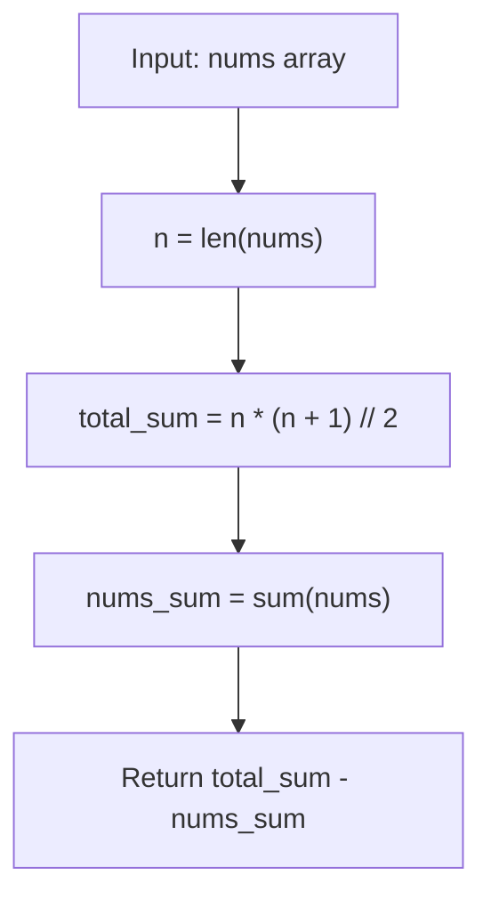

# LC 268 - Missing Number

## Problem

Given an array `nums` containing `n` distinct numbers in the range `[0, n]`, return the **one number** that is missing from the array.

**Constraints:**

- `n == nums.length`
- `1 <= n <= 10^4`
- `0 <= nums[i] <= n`
- All the numbers of `nums` are unique

---

## Examples

### Example 1

```
Input:  nums = [3, 0, 1]
Output: 2
```

**Explanation:**
```
n = 3, so the full range is [0, 1, 2, 3].
The missing number is 2.
```

---

### Example 2

```
Input:  nums = [0, 1]
Output: 2
```

**Explanation:**
```
n = 2, so the full range is [0, 1, 2].
The missing number is 2.
```

---

### Example 3

```
Input:  nums = [9, 6, 4, 2, 3, 5, 7, 0, 1]
Output: 8
```

**Explanation:**
```
n = 9, so the full range is [0, 1, ..., 9].
The missing number is 8.
```

---

## Approach: Arithmetic Series Sum

### Key Insight

The sum of all integers from `0` to `n` is given by the arithmetic series formula:

```
sum(0..n) = n * (n + 1) / 2
```

If we compute the sum of all elements in `nums` and subtract it from this total, the difference is exactly the missing number.

### Algorithm

1. Let `n = len(nums)`.
2. Compute `total_sum = n * (n + 1) // 2` (the sum of `0..n`).
3. Compute `nums_sum = sum(nums)` (the sum of the given array).
4. Return `total_sum - nums_sum`.

```python
class Solution:
    def missingNumber(self, nums: list[int]) -> int:
        n = len(nums)
        total_sum = (n * (n + 1)) // 2
        nums_sum = sum(nums)
        return total_sum - nums_sum
```

---

## Complexity Analysis

| | Time | Space |
|--|------|-------|
| **missingNumber** | **O(n)** — one pass to sum the array | **O(1)** — only two variables are used |

> Time is optimal: every element must be read, so Ω(n) work is required.

---

## Flowchart



---

## Example Test Case Trace

**Input:** `nums = [3, 0, 1]`

### Step-by-step

| Step | Action | Value |
|------|--------|-------|
| 1 | `n = len(nums)` | 3 |
| 2 | `total_sum = 3 * 4 // 2` | 6 |
| 3 | `nums_sum = 3 + 0 + 1` | 4 |
| 4 | `return 6 - 4` | 2 |

**Final result:** `2`

---

## Run Tests

From the **repository root**:

```bash
python -m Array.LC_268.test
```

Expected output:

```
=== LC 268: Missing Number ===

PASS: missingNumber([3, 0, 1])
  Expected: 2
  Got:      2
...
```

The `test.py` covers: both LeetCode examples, single element, missing 0, missing n, missing middle, a 21-element array, and random-order arrays.

---

## Alternative Approaches

| Approach | Time | Space | Notes |
|----------|------|-------|-------|
| Arithmetic series sum (this file) | O(n) | O(1) | Optimal; simplest math-based solution |
| XOR | O(n) | O(1) | `xor = 0 ^ 1 ^ ... ^ n ^ nums[0] ^ ... ^ nums[n-1]`; avoids overflow |
| Sorting | O(n log n) | O(1) | Sort then find the first mismatch; slower |
| Hash set | O(n) | O(n) | Store all nums, then check 0..n; extra space |

### XOR Version (for reference)

```python
class Solution:
    def missingNumber(self, nums: list[int]) -> int:
        n = len(nums)
        xor = n
        for i, num in enumerate(nums):
            xor ^= i ^ num
        return xor
```

---

## Interview Questions

### Q1. Does this modify the input array?

**Answer**: No. The method only reads elements; `nums` is untouched.

### Q2. What if the array is very large and the sum overflows?

**Answer**: In Python, integers have arbitrary precision, so overflow isn't an issue. In languages like C++/Java, use the XOR approach or `long long` to avoid overflow. The XOR method never produces a value larger than `n`.

### Q3. Why is the XOR approach also O(n) / O(1)?

**Answer**: XOR is commutative and associative, and `x ^ x = 0`. XORing all numbers `0..n` with all elements of `nums` cancels out every present number, leaving only the missing one. It avoids the multiplication that could overflow in fixed-width integer types.

### Q4. What if there are multiple missing numbers?

**Answer**: The problem guarantees exactly one missing number. If multiple were missing, the single-difference approach wouldn't work — you'd need a different strategy (e.g., sorting or a hash set).

---

## File Structure

```
Array/
└── LC_268/
    ├── code.py    # Solution.missingNumber using arithmetic series sum
    ├── test.py    # Runnable tests (print-based assertions)
    └── README.md  # Documentation
```