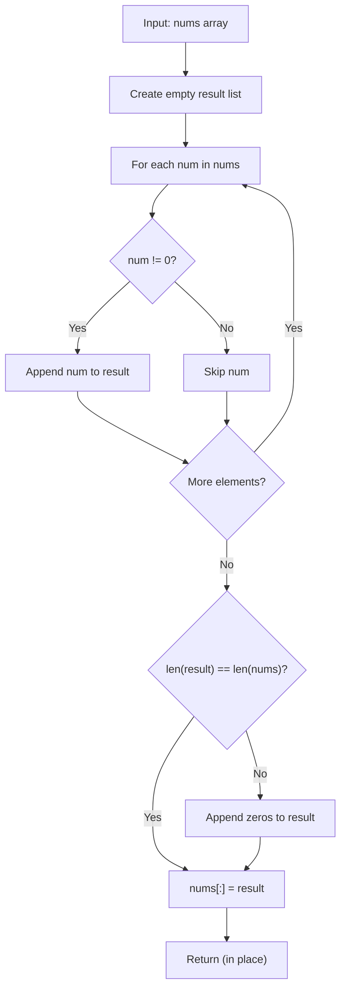

# LC 283 - Move Zeroes

## Problem

Given an integer array `nums`, move all `0`s to the **end** of it while maintaining the **relative order** of the non-zero elements.

The operation must be done **in place** — do not make a copy of the array.

**Constraints:**

- `1 <= nums.length <= 10^4`
- `-2^31 <= nums[i] <= 2^31 - 1`

---

## Examples

### Example 1

```
Input:  nums = [0, 1, 0, 3, 12]
Output: [1, 3, 12, 0, 0]
```

**Explanation:**
```
Non-zero elements: [1, 3, 12] keep their relative order.
Zeros: [0, 0] are moved to the end.
```

---

### Example 2

```
Input:  nums = [0]
Output: [0]
```

---

### Example 3

```
Input:  nums = [1, 2, 3]
Output: [1, 2, 3]
```

**Explanation:**
```
No zeros present — the array is unchanged.
```

---

## Approach: Collect Non-Zeros + Append Zeros

### Key Insight

The relative order of non-zero elements must be preserved, so we can't just swap. The simplest correct approach is to:

1. Collect all non-zero elements into a new list (preserving order).
2. Append the required number of zeros at the end.
3. Write the result back into `nums` in place via `nums[:] = result`.

### Algorithm

1. Iterate over `nums`, appending every non-zero element to `result`.
2. If `len(result) != len(nums)`, some zeros were skipped — append `len(nums) - len(result)` zeros to `result`.
3. Assign `nums[:] = result` to update the original list in place.

```python
class Solution:
    def moveZeroes(self, nums: list[int]) -> None:
        result = []

        for num in nums:
            if num != 0:
                result.append(num)

        if len(result) != len(nums):
            zeros_needed = len(nums) - len(result)
            zeros = [0] * zeros_needed
            result.extend(zeros)

        nums[:] = result
```

---

## Complexity Analysis

| | Time | Space |
|--|------|-------|
| **moveZeroes** | **O(n)** — one pass to collect non-zeros, one pass to write back | **O(n)** — the `result` list holds all elements |

> Time is optimal: every element must be examined, so Ω(n) work is required. Space could be reduced to O(1) with the two-pointer approach (see Alternative Approaches).

---

## Flowchart



---

## Example Test Case Trace

**Input:** `nums = [0, 1, 0, 3, 12]`

### Step-by-step

| Step | num | Action | result |
|------|-----|--------|--------|
| 0 | — | initial | `[]` |
| 1 | 0 | skip (zero) | `[]` |
| 2 | 1 | append | `[1]` |
| 3 | 0 | skip (zero) | `[1]` |
| 4 | 3 | append | `[1, 3]` |
| 5 | 12 | append | `[1, 3, 12]` |
| 6 | — | 2 zeros needed; append `[0, 0]` | `[1, 3, 12, 0, 0]` |
| 7 | — | `nums[:] = result` | `[1, 3, 12, 0, 0]` |

**Final result:** `[1, 3, 12, 0, 0]`

---

## Run Tests

From the **repository root**:

```bash
python -m Array.LC_283.test
```

Expected output:

```
=== LC 283: Move Zeroes ===

PASS: moveZeroes([0, 1, 0, 3, 12])
  Expected: [1, 3, 12, 0, 0]
  Got:      [1, 3, 12, 0, 0]
...
```

The `test.py` covers: the LeetCode example, single zero, single non-zero, all zeros, no zeros, multiple zeros scattered, empty array, and a 10-element array.

---

## Alternative Approaches

| Approach | Time | Space | Notes |
|----------|------|-------|-------|
| Collect non-zeros + append zeros (this file) | O(n) | O(n) | Simplest; uses extra list |
| Two pointers (in place) | O(n) | O(1) | Optimal space; swaps non-zeros forward |
| Snowball (count zeros, shift) | O(n) | O(1) | Similar to two pointers; tracks zero count |

### Two-Pointer In-Place Version (for reference)

```python
class Solution:
    def moveZeroes(self, nums: list[int]) -> None:
        last_non_zero = 0
        for i in range(len(nums)):
            if nums[i] != 0:
                nums[last_non_zero], nums[i] = nums[i], nums[last_non_zero]
                last_non_zero += 1
```

---

## Interview Questions

### Q1. Does this modify the input array?

**Answer**: Yes. The method updates `nums` in place via `nums[:] = result` and returns `None`.

### Q2. Why use `nums[:] = result` instead of `nums = result`?

**Answer**: `nums = result` would rebind the local variable, leaving the caller's list unchanged. `nums[:] = result` mutates the existing list object in place, so the caller sees the change.

### Q3. Can we do this with O(1) extra space?

**Answer**: Yes — the two-pointer approach swaps non-zero elements forward, using only two index variables. This is the optimal-space solution and is what most interviewers expect.

### Q4. What about negative numbers or values other than zero?

**Answer**: The condition `num != 0` only moves exact zeros. Negative numbers and other non-zero values are treated as non-zero and keep their relative order.

---

## File Structure

```
Array/
└── LC_283/
    ├── code.py    # Solution.moveZeroes using collect + append
    ├── test.py    # Runnable tests (print-based assertions)
    └── README.md  # Documentation
```