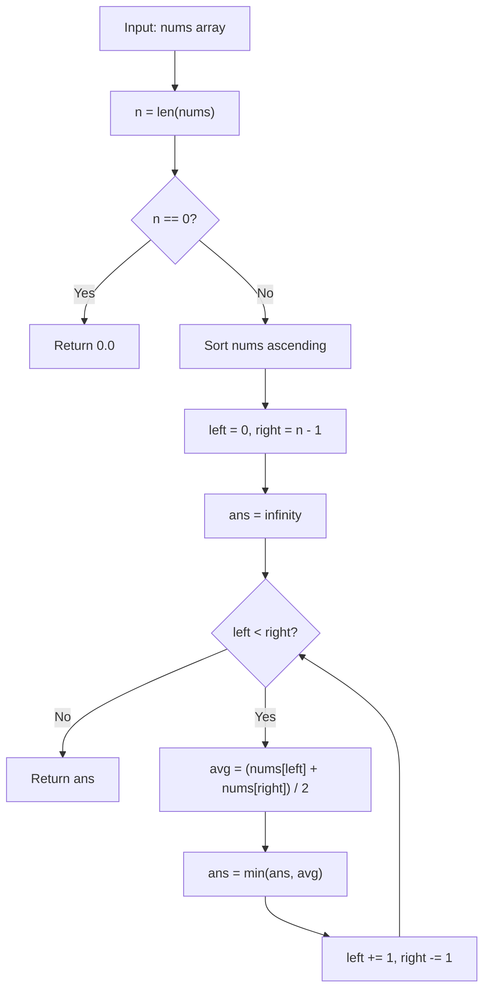

# LC 3194 - Minimum Average of Smallest and Largest Elements

## Problem

You have an array `nums` of `n` integers, where `n` is **even**. You repeat the following procedure `n / 2` times:

1. Remove the **smallest** element (`minElement`) and the **largest** element (`maxElement`) from `nums`.
2. Add `(minElement + maxElement) / 2` to a list `averages`.

Return the **minimum** element in `averages`.

**Constraints:**

- `2 <= nums.length <= 10^5`
- `nums.length` is even
- `1 <= nums[i] <= 10^5`

---

## Examples

### Example 1

```
Input:  nums = [7, 8, 3, 4, 15, 13, 4, 1]
Output: 5.5
```

**Explanation:**

| step | nums | averages |
|------|------|----------|
| 0 | `[7, 8, 3, 4, 15, 13, 4, 1]` | `[]` |
| 1 | `[7, 8, 3, 4, 13, 4]` | `[8]` |
| 2 | `[7, 8, 4, 4]` | `[8, 8]` |
| 3 | `[7, 4]` | `[8, 8, 6]` |
| 4 | `[]` | `[8, 8, 6, 5.5]` |

The smallest element of `averages` is `5.5`.

---

### Example 2

```
Input:  nums = [1, 9, 8, 3, 10, 5]
Output: 5.5
```

**Explanation:**

After sorting: `[1, 3, 5, 8, 9, 10]`. Pairs: `(1, 10) -> 5.5`, `(3, 9) -> 6.0`, `(5, 8) -> 6.5`. Minimum is `5.5`.

---

## Approach: Sort + Two Pointers

### Key Insight

After sorting `nums`, the smallest element is at index `0` and the largest at index `n - 1`. The procedure always removes the current smallest and current largest, which after sorting are exactly the elements moving inward from both ends. So the pairs are:

```
(nums[0], nums[n-1]), (nums[1], nums[n-2]), ..., (nums[n/2 - 1], nums[n/2])
```

The `i`-th smallest pairs with the `i`-th largest, averaging `(nums[i] + nums[n-1-i]) / 2`. We just need the minimum of these averages.

### Algorithm

1. Sort `nums` in ascending order.
2. Initialize `left = 0`, `right = n - 1`, and `ans = infinity`.
3. While `left < right`:
   - Compute `avg = (nums[left] + nums[right]) / 2`.
   - Update `ans = min(ans, avg)`.
   - Move `left` forward and `right` backward.
4. Return `ans`.

```python
class Solution:
    def minimumAverage(self, nums: list[int]) -> float:
        n = len(nums)
        if n == 0:
            return 0.0

        nums.sort()
        ans = float("inf")
        left = 0
        right = n - 1
        while left < right:
            avg = (nums[left] + nums[right]) / 2
            ans = min(ans, avg)
            left += 1
            right -= 1
        return ans
```

---

## Complexity Analysis

| | Time | Space |
|--|------|-------|
| **minimumAverage** | **O(n log n)** — dominated by sorting | **O(log n)** — Timsort recursion stack (sorting in place) |

> The two-pointer scan itself is O(n), but sorting dominates. A multiset-based simulation would be O(n^2) or O(n log n) with a balanced BST, so sorting is the simplest and fastest approach.

---

## Flowchart



---

## Example Test Case Trace

**Input:** `nums = [7, 8, 3, 4, 15, 13, 4, 1]`

### Step 1: Sort

`nums = [1, 3, 4, 4, 7, 8, 13, 15]`

### Step 2: Pair and average

| Step | left | right | nums[left] | nums[right] | avg | ans |
|------|------|-------|------------|-------------|-----|-----|
| 1 | 0 | 7 | 1 | 15 | 8.0 | 8.0 |
| 2 | 1 | 6 | 3 | 13 | 8.0 | 8.0 |
| 3 | 2 | 5 | 4 | 8 | 6.0 | 6.0 |
| 4 | 3 | 4 | 4 | 7 | 5.5 | 5.5 |

**Final result:** `5.5`

---

## Run Tests

From the **repository root**:

```bash
python -m Array.LC_3194.test
```

Expected output:

```
=== LC 3194: Minimum Average of Smallest and Largest Elements ===

PASS: minimumAverage([7, 8, 3, 4, 15, 13, 4, 1])
  Expected: 5.5
  Got:      5.5
...
```

The `test.py` covers: both LeetCode examples, small even arrays, all-equal values, extreme two-element arrays, and large values.

---

## Alternative Approaches

| Approach | Time | Space | Notes |
|----------|------|-------|-------|
| Sort + two pointers (this file) | O(n log n) | O(log n) | Optimal; sort dominates |
| Deque simulation | O(n log n) | O(n) | Sort + `deque.popleft()`/`pop()`; same complexity, more overhead |
| Multiset / balanced BST | O(n log n) | O(n) | Remove min/max repeatedly; more complex |
| Brute force (repeated min/max scan) | O(n^2) | O(1) | Too slow for n up to 10^5 |

---

## Interview Questions

### Q1. Why does sorting first work?

**Answer**: The procedure always removes the current smallest and current largest. After sorting, those are exactly the elements at the two ends of the array, so we never need to search for them — two pointers suffice.

### Q2. Does this modify the input array?

**Answer**: Yes. `nums.sort()` sorts in place. If the original order must be preserved, sort a copy: `sorted(nums)`.

### Q3. What if `n` is odd?

**Answer**: The problem guarantees `n` is even. If it weren't, the middle element would be left over after pairing, and the definition of `averages` would need clarification.

### Q4. Can we avoid floating-point issues?

**Answer**: Since all averages are of the form `(a + b) / 2`, comparing two averages is equivalent to comparing `a + b`. We could track the minimum sum and divide by 2 only at the end, but floating-point `double` is precise enough for the constraints here (`nums[i] <= 10^5`, sums up to `2 * 10^5`).

---

## File Structure

```
Array/
└── LC_3194/
    ├── code.py    # Solution.minimumAverage using sort + two pointers
    ├── test.py    # Runnable tests (print-based assertions)
    └── README.md  # Documentation
```