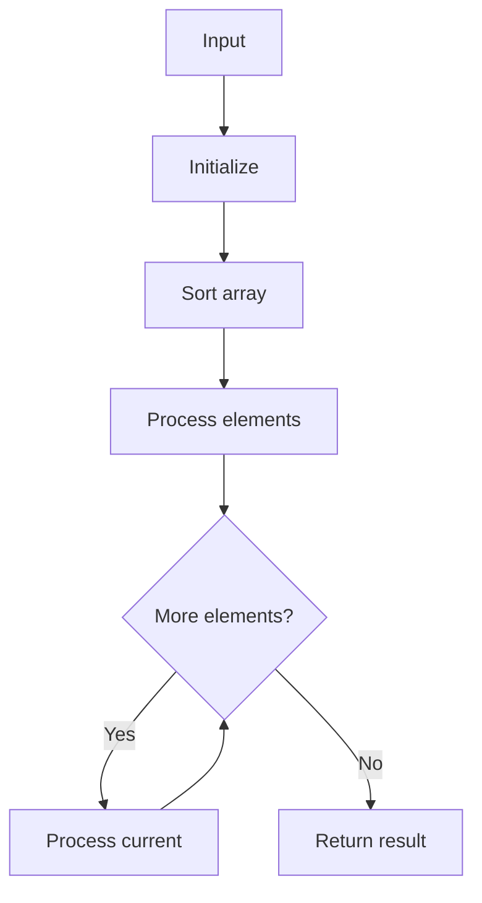

# LC 56 Merge Intervals

## Problem

Merge all overlapping intervals.

## Approach

Sort by start; merge if current start <= prev end.

## Complexity

O(n log n) time, O(n) space.



## Run Tests

```bash
python -m Array.LC_56.test
```
