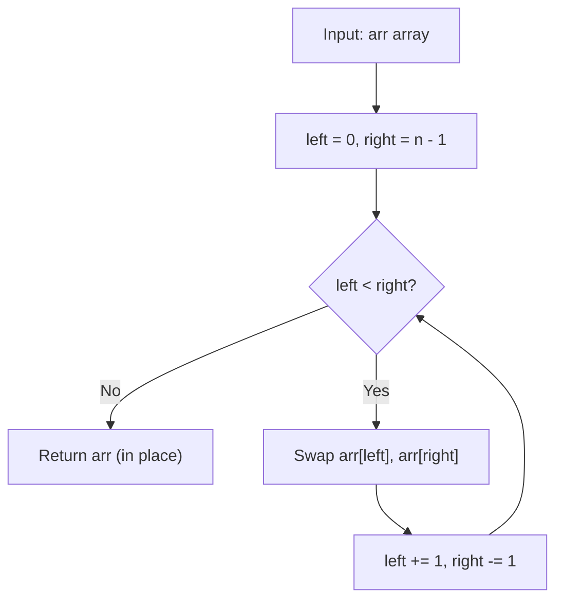

# GFG Reverse Array

## Problem

Given an array `arr`, **reverse** the order of its elements **in place**.

```
arr = [a1, a2, ..., an]  ->  [an, a(n-1), ..., a1]
```

---

## Examples

### Example 1

```
Input:  arr = [1, 2, 3, 4, 5]
Output: [5, 4, 3, 2, 1]
```

---

### Example 2

```
Input:  arr = [1, 2, 3, 4]
Output: [4, 3, 2, 1]
```

---

### Example 3

```
Input:  arr = [1]
Output: [1]
```

---

## Approach: Two Pointers (In Place)

### Key Insight

We use two pointers starting from both ends of the array:

- `left` starts at index `0`.
- `right` starts at index `n - 1`.

We swap `arr[left]` with `arr[right]`, then move `left` forward and `right` backward. This continues until `left >= right`. For an array of `n` elements, only `n / 2` swaps are needed.

### Algorithm

1. Initialize `left = 0`, `right = len(arr) - 1`.
2. While `left < right`:
   - Swap `arr[left]` and `arr[right]`.
   - Increment `left`, decrement `right`.
3. Return `arr` (already mutated in place).

```python
class Solution:
    def reverseArray(self, arr: list[int]) -> list[int]:
        left = 0
        right = len(arr) - 1
        while left < right:
            arr[left], arr[right] = arr[right], arr[left]
            left += 1
            right -= 1
        return arr
```

---

## Complexity Analysis

| | Time | Space |
|--|------|-------|
| **reverseArray** | **O(n)** — `n / 2` swaps, each O(1) | **O(1)** — only two index variables are used |

> Time is optimal: every element must be touched, so Ω(n) work is required. Space is optimal: no extra array is allocated.

---

## Flowchart



---

## Example Test Case Trace

**Input:** `arr = [1, 2, 3, 4, 5]`

### Step-by-step

| Step | left | right | Swap | arr after |
|------|------|-------|------|-----------|
| 0 | 0 | 4 | arr[0] ↔ arr[4] | `[5, 2, 3, 4, 1]` |
| 1 | 1 | 3 | arr[1] ↔ arr[3] | `[5, 4, 3, 2, 1]` |
| 2 | 2 | 2 | loop ends (2 < 2 is False) | `[5, 4, 3, 2, 1]` |

**Final result:** `[5, 4, 3, 2, 1]`

---

## Run Tests

From the **repository root**:

```bash
python -m Array.Reverse_Array.test
```

Expected output:

```
=== GFG: Reverse Array ===

PASS: reverseArray([1, 2, 3, 4, 5])
  Expected: [5, 4, 3, 2, 1]
  Got:      [5, 4, 3, 2, 1]
...
```

The `test.py` covers: odd length, even length, single element, empty array, two elements, zeros, negatives, and repeated values.

---

## Alternative Approaches

| Approach | Time | Space | Notes |
|----------|------|-------|-------|
| Two pointers (this file) | O(n) | O(1) | Optimal in both time and space |
| `arr.reverse()` | O(n) | O(1) | Python built-in; same complexity; preferred in practice |
| `arr[::-1]` | O(n) | O(n) | Creates a new reversed list; original unchanged |
| Recursive | O(n) | O(n) | Elegant but uses call-stack space |
| Stack-based | O(n) | O(n) | Push all, pop all; more overhead |

---

## Interview Questions

### Q1. Does this modify the input array?

**Answer**: Yes. The method swaps elements in place and returns the same list. The original order is lost.

### Q2. How many swaps are needed?

**Answer**: `n // 2` swaps. For odd-length arrays, the middle element doesn't need to move.

### Q3. Why use `left < right` and not `left <= right`?

**Answer**: When `left == right` (odd-length arrays), the element is in the middle and doesn't need to move. Swapping it with itself is harmless but unnecessary. Using `left < right` avoids the extra iteration.

### Q4. Can we do this recursively?

**Answer**: Yes — `reverse(arr, left, right)` swaps `arr[left]` and `arr[right]`, then recurses with `left+1, right-1`. Base case: `left >= right`. But this uses O(n) call-stack space, so the iterative version is preferred.

---

## File Structure

```
Array/
└── Reverse_Array/
    ├── code.py    # Solution.reverseArray using two pointers
    ├── test.py    # Runnable tests (print-based assertions)
    └── README.md  # Documentation
```