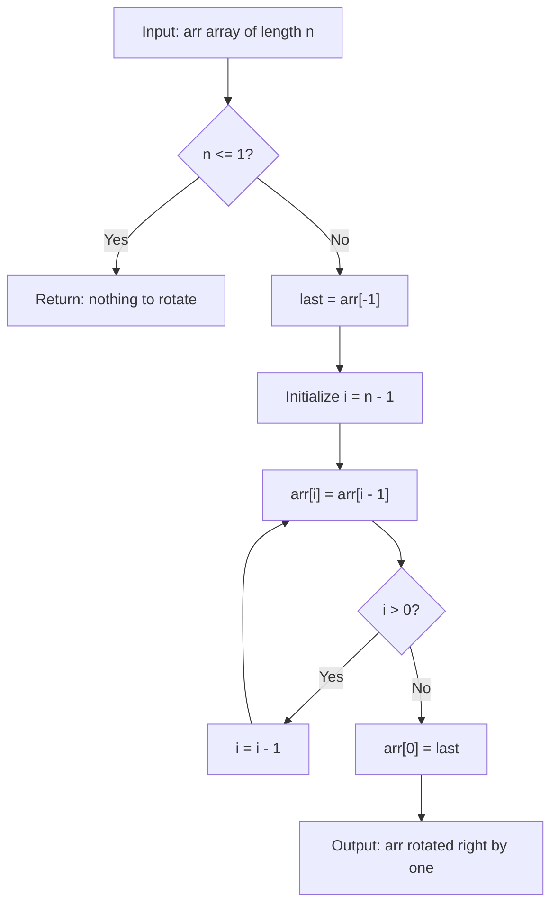

# GFG Rotate Array by One

## Problem

Given an array `arr` of size `n`, rotate it by **one position in clockwise direction** — the last element comes to the front, and every other element shifts one place to the right.

```
arr = [a1, a2, a3, ..., an]  ->  [an, a1, a2, ..., a(n-1)]
```

> Note: This is the `k = 1` case of **LeetCode 189 (Rotate Array)**. The rotation is performed **in place**, so `rotate` mutates the list and returns `None`.

---

## Examples

### Example 1

```
Input:  arr = [1, 2, 3, 4, 5]
Output: [5, 1, 2, 3, 4]
```

**Explanation:**
```
last = arr[-1] = 5
shift right: [1, 2, 3, 4, 4] -> [1, 2, 3, 4, 4] -> ... -> [0, 1, 2, 3, 4]
arr[0] = last -> [5, 1, 2, 3, 4]
```

---

### Example 2

```
Input:  arr = [7, 8, 9]
Output: [9, 7, 8]
```

---

## Approach: In-Place Right Shift

### Key Insight

A right rotation by one is a **right shift by one**. Only two things have to happen:

1. Every element moves one index to the right — which is a **backward** traversal, because a forward traversal would overwrite the value we still need.
2. The element that fell off the end (`arr[-1]`, saved *before* the shift) is placed at index `0`.

### Algorithm

1. If the array has `0` or `1` element, there is nothing to rotate — return.
2. Save `last = arr[-1]` (the element that will wrap around to the front).
3. Traverse `i` from `n - 1` down to `1` and set `arr[i] = arr[i - 1]`.
4. Set `arr[0] = last`.

```python
class Solution:
    def rotate(self, arr: list[int]) -> None:
        n = len(arr)

        if n <= 1:
            return

        last = arr[-1]

        for i in range(n - 1, 0, -1):
            arr[i] = arr[i - 1]

        arr[0] = last
```

### Why traverse backwards?

| Direction | What happens |
|-----------|--------------|
| Forward (`i` from `0` to `n-2`) | `arr[1] = arr[0]` destroys `arr[0]` before it can be copied to `arr[2]` — the array ends up as `[a, a, a, a, a]` |
| Backward (`i` from `n-1` down to `1`) | `arr[i]` is overwritten **after** `arr[i-1]` was already copied — every original value survives exactly once |

---

## Complexity Analysis

| | Time | Space |
|--|------|-------|
| **rotate** | **O(n)** — one backward pass over `n` elements | **O(1)** — only the `last` temporary is used |

> Time is optimal: every element has to be moved, so any in-place solution needs Ω(n) work.

---

## Flowchart



---

## Example Test Case Trace

**Input:** `arr = [1, 2, 3, 4, 5]`

### Step-by-step

| Step | Action | arr |
|------|--------|-----|
| 0 | initial state | `[1, 2, 3, 4, 5]` |
| 1 | `last = arr[-1]` | `[1, 2, 3, 4, 5]` |
| 2 | `i = 4`: `arr[4] = arr[3]` | `[1, 2, 3, 4, 4]` |
| 3 | `i = 3`: `arr[3] = arr[2]` | `[1, 2, 3, 3, 4]` |
| 4 | `i = 2`: `arr[2] = arr[1]` | `[1, 2, 2, 3, 4]` |
| 5 | `i = 1`: `arr[1] = arr[0]` | `[1, 1, 2, 3, 4]` |
| 6 | `arr[0] = last` | `[5, 1, 2, 3, 4]` |

### Final result

```
arr = [5, 1, 2, 3, 4]
```

---

## Run Tests

From the **repository root**:

```bash
python -m Array.Rotate_Array_By_One.test
```

Expected output:

```
=== GFG: Rotate Array by One ===

PASS: rotate([1, 2, 3, 4, 5])
  Expected: [5, 1, 2, 3, 4]
  Got:      [5, 1, 2, 3, 4]
...
```

The `test.py` covers: the classic GFG example, single element, empty array, two elements, values containing zero, all-equal elements, negative numbers, mixed duplicates, and a 10-element array.

---

## Alternative Approaches

| Approach | Time | Space | Notes |
|----------|------|-------|-------|
| Right shift in place (this file) | O(n) | O(1) | Optimal space; one backward pass |
| `arr.insert(0, arr.pop())` | O(n) | O(1) | One line, but hides the mechanics |
| `arr[-1:] + arr[:-1]` | O(n) | O(n) | Allocates a new array; not in place |
| Reversal trick (rotate by `k`) | O(n) | O(1) | Generalises to any `k` — see `Array/LC_189` |

---

## Interview Questions

### Q1. Does this modify the input array?

**Answer**: Yes. The rotation is done **in place**, so `arr` holds the rotated values after the call and the method returns `None`. If the original order must be preserved, pass a copy: `arr = list(arr)`.

### Q2. Why does the loop stop at index `1` and not `0`?

**Answer**: `arr[0]` is overwritten at the end with the saved `last` element. Shifting into index `0` would be overwritten anyway, so the loop only needs to fill indices `n - 1` down to `1`.

### Q3. What happens for an array of length 0 or 1?

**Answer**: Nothing needs to move, so the method returns immediately — `n <= 1` is checked before `arr[-1]` is read (an empty list would raise `IndexError` otherwise).

### Q4. How would you generalise this to rotate by `k` positions?

**Answer**: Use the reversal trick — reverse the whole array, reverse the first `k` elements, reverse the last `n - k` elements. That is the same idea behind the three-reverse solution of **LeetCode 189**.

---

## File Structure

```
Array/
└── Rotate_Array_By_One/
    ├── code.py    # Solution.rotate - in-place right shift by one
    ├── test.py    # Runnable tests (print-based assertions)
    └── README.md  # Documentation
```
