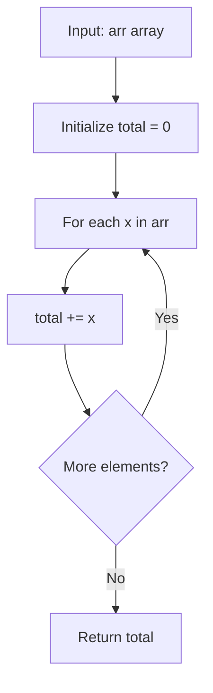

# GFG Sum of Array

## Problem

Given an array `arr`, return the **sum** of all its elements.

```
total = arr[0] + arr[1] + ... + arr[n-1]
```

---

## Examples

### Example 1

```
Input:  arr = [1, 2, 3, 4, 5]
Output: 15
```

---

### Example 2

```
Input:  arr = []
Output: 0
```

---

### Example 3

```
Input:  arr = [-1, -2, -3]
Output: -6
```

---

## Approach: Accumulator Loop

### Key Insight

The sum of an array is the result of adding every element together. The simplest implementation is a loop that accumulates the total in a variable.

### Algorithm

1. Initialize `total = 0`.
2. For each element `x` in `arr`, add `x` to `total`.
3. Return `total`.

```python
class Solution:
    def arraySum(self, arr):
        total = 0
        for x in arr:
            total += x
        return total
```

---

## Complexity Analysis

| | Time | Space |
|--|------|-------|
| **arraySum** | **O(n)** — one pass over the `n` elements | **O(1)** — only the `total` variable is used |

> Time is optimal: every element must be read, so Ω(n) work is required.

---

## Flowchart



---

## Example Test Case Trace

**Input:** `arr = [1, 2, 3, 4, 5]`

| Step | x | total |
|------|---|-------|
| 0 | — | 0 |
| 1 | 1 | 1 |
| 2 | 2 | 3 |
| 3 | 3 | 6 |
| 4 | 4 | 10 |
| 5 | 5 | 15 |

**Final result:** `15`

---

## Run Tests

From the **repository root**:

```bash
python -m Array.Sum_of_Array.test
```

Expected output:

```
=== GFG: Sum of Array ===

PASS: arraySum([])
  Expected: 0
  Got:      0
...
```

The `test.py` covers: empty array, single element, standard case, negatives, zeros, duplicates, large values, and repeated values.

---

## Alternative Approaches

| Approach | Time | Space | Notes |
|----------|------|-------|-------|
| Accumulator loop (this file) | O(n) | O(1) | Optimal space; explicit and readable |
| `sum(arr)` | O(n) | O(1) | Python built-in; same complexity; preferred in practice |
| `functools.reduce(operator.add, arr)` | O(n) | O(1) | Functional style; more verbose |

---

## Interview Questions

### Q1. Does this modify the input array?

**Answer**: No. The method only reads the elements; `arr` is untouched.

### Q2. What is the sum of an empty array?

**Answer**: `0`. The accumulator starts at `0` and the loop never runs, so the result is `0` — the standard mathematical convention for the empty sum.

### Q3. Why not just use `sum(arr)`?

**Answer**: `sum(arr)` is the idiomatic Python choice and has the same O(n) / O(1) complexity. The explicit loop here is the pedagogical equivalent — it shows the mechanics step by step and is what most interviewers expect as a hand-written solution.

---

## File Structure

```
Array/
└── Sum_of_Array/
    ├── code.py    # Solution.arraySum using an accumulator loop
    ├── test.py    # Runnable tests (print-based assertions)
    └── README.md  # Documentation
```