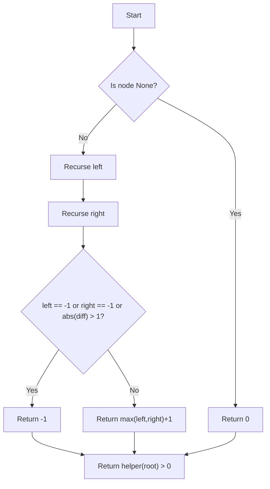

# GFG Balanced Tree Check

Given a binary tree, determine whether it is height-balanced. A binary tree is balanced if, for every node, the height difference between its left and right subtrees is at most 1.

## Problem Statement

You are given the root of a binary tree. Write a function `isBalanced(root)` that returns `True` if the tree is height-balanced and `False` otherwise.

A **binary tree node** is defined as:

```python
class Node:
    def __init__(self, val):
        self.data = val
        self.left = None
        self.right = None
```

## Theory

A tree is height-balanced if for every node, the absolute difference between the heights of its left and right subtrees is at most 1, and both subtrees are also balanced.

We can compute this efficiently in a single post-order traversal. The helper function returns the height of the subtree if it is balanced, or `-1` if it is unbalanced. This avoids recomputing heights multiple times.

## Algorithm

1. Define a recursive helper `helper(node)`:
   a. If `node` is `None`, return 0 (height of empty tree).
   b. Recursively compute `left_height = helper(node.left)`.
   c. Recursively compute `right_height = helper(node.right)`.
   d. If either is `-1` (unbalanced) or `abs(left_height - right_height) > 1`, return `-1`.
   e. Otherwise return `max(left_height, right_height) + 1`.
2. Call `helper(root)`; return `True` if the result is greater than 0, else `False`.

## Complexity Analysis

| Aspect | Complexity |
|--------|------------|
| Time   | **O(N)** – each node is visited once |
| Space  | **O(H)** – recursion stack depth equal to tree height |

## Implementation

```python
'''
# Structure of binary tree node
class Node:
    def __init__(self, val):
        self.data = val
        self.right = None
        self.left = None
'''

class Solution:
    def isBalanced(self, root):
        
        def helper(root):
            if root is None :
                return 0
            left_node = helper(root.left)
            right_node = helper(root.right)
            
            if left_node == -1 or right_node == -1 or abs(left_node - right_node) > 1:
                return -1 
            return max(left_node, right_node) + 1 
            
        
        return helper(root) >  0
```

## Examples

### Example 1
```
Input:
     1
   /   \
  2     3
 / \   / \
4   5 6   7

Output: True
```

### Example 2
```
Input:
     1
      \
       2
        \
         3

Output: False
```

### Example 3
```
Input: Empty tree

Output: False (per this implementation)
```

## Running the Tests

Run tests from the repository root:

```bash
PYTHONPATH=. python BinaryTree/GFG_Balanced_Tree_Check/test.py
```

Expected output:

```
=== GFG: Balanced Tree Check ===

PASS: isBalanced([1, 2, 3])
  Expected: True
  Got:      True

PASS: isBalanced([1, 2, 3, 4, 5, 6, 7])
  Expected: True
  Got:      True

PASS: isBalanced([1, None, 2, None, 3])
  Expected: False
  Got:      False

PASS: isBalanced([1])
  Expected: True
  Got:      True

PASS: isBalanced([])
  Expected: False
  Got:      False

All GFG_Balanced_Tree_Check tests passed.
```

## File Structure

```
BinaryTree/
└── GFG_Balanced_Tree_Check/
    ├── code.py    # Node and Solution implementation
    ├── test.py    # Unit tests
    └── README.md  # Documentation
```


