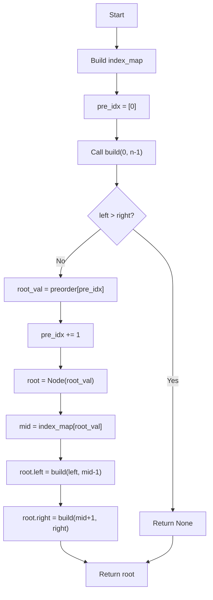

# GFG Construct Tree from Inorder & Preorder

Given inorder and preorder traversals of a binary tree, construct the original binary tree.

## Problem Statement

You are given two arrays `inorder` and `preorder` representing the inorder and preorder traversals of a binary tree. Write a function `buildTree(inorder, preorder)` that returns the root of the constructed tree.

A **binary tree node** is defined as:

```python
class Node:
    def __init__(self, val):
        self.data = val
        self.left = None
        self.right = None
```

## Theory

In preorder traversal, the first element is always the root. We can find this root in the inorder array; elements to its left form the left subtree and elements to its right form the right subtree. We recursively build left and right subtrees.

To make lookup O(1), we build a hash map from value to index in the inorder array. We track the current preorder index using a mutable container (list).

## Algorithm

1. Build `index_map = {val: i for i, val in enumerate(inorder)}`.
2. Initialize `pre_idx = [0]`.
3. Define a recursive helper `build(left, right)`:
   a. If `left > right`, return `None`.
   b. `root_val = preorder[pre_idx[0]]`; increment `pre_idx[0]`.
   c. `root = Node(root_val)`.
   d. `mid = index_map[root_val]`.
   e. `root.left = build(left, mid - 1)`.
   f. `root.right = build(mid + 1, right)`.
   g. Return `root`.
4. Return `build(0, len(inorder) - 1)`.

## Complexity Analysis

| Aspect | Complexity |
|--------|------------|
| Time   | **O(N)** – each node created once; hash map gives O(1) lookup |
| Space  | **O(N)** – hash map and recursion stack |

## Implementation

```python
# Definition for Node
class Node:
    def __init__(self, val):
        self.data = val
        self.left = None
        self.right = None

class Solution:
    def buildTree(self, inorder, preorder):
        index_map = {val: i for i, val in enumerate(inorder)}
        pre_idx = [0]

        def build(left, right):
            if left > right:
                return None
            root_val = preorder[pre_idx[0]]
            pre_idx[0] += 1
            root = Node(root_val)
            mid = index_map[root_val]
            root.left = build(left, mid - 1)
            root.right = build(mid + 1, right)
            return root

        return build(0, len(inorder) - 1)
```

## Examples

### Example 1
```
Inorder:  [4, 2, 5, 1, 6, 3, 7]
Preorder: [1, 2, 4, 5, 3, 6, 7]

Tree:
         1
       /   \
      2     3
     / \   / \
    4   5 6   7
```

### Example 2
```
Inorder:  [2, 1, 3]
Preorder: [1, 2, 3]

Tree:
       1
     /   \
    2     3
```

## Running the Tests

Run tests from the repository root:

```bash
PYTHONPATH=. python BinaryTree/GFG_Construct_Tree_from_Inorder_and_Preorder/test.py
```

Expected output:

```
=== GFG: Construct Tree from Inorder & Preorder ===

PASS: buildTree(inorder=[4, 2, 5, 1, 6, 3, 7], preorder=[1, 2, 4, 5, 3, 6, 7])
  Inorder:  [4, 2, 5, 1, 6, 3, 7] (expected [4, 2, 5, 1, 6, 3, 7])
  Preorder: [1, 2, 4, 5, 3, 6, 7] (expected [1, 2, 4, 5, 3, 6, 7])

PASS: buildTree(inorder=[1], preorder=[1])
  Inorder:  [1] (expected [1])
  Preorder: [1] (expected [1])

PASS: buildTree(inorder=[], preorder=[])
  Inorder:  [] (expected [])
  Preorder: [] (expected [])

PASS: buildTree(inorder=[2, 1, 3], preorder=[1, 2, 3])
  Inorder:  [2, 1, 3] (expected [2, 1, 3])
  Preorder: [1, 2, 3] (expected [1, 2, 3])

All GFG_Construct_Tree_from_Inorder_and_Preorder tests passed.
```

## File Structure

```
BinaryTree/
└── GFG_Construct_Tree_from_Inorder_and_Preorder/
    ├── code.py    # Node and Solution implementation
    ├── test.py    # Unit tests
    └── README.md  # Documentation
```


