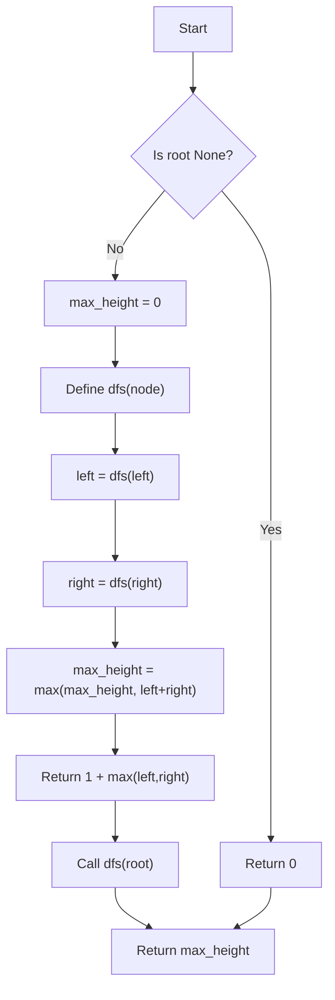

# GFG Diameter of Binary Tree

Given a binary tree, find its diameter. The diameter is the number of edges on the longest path between any two nodes in the tree. This path may or may not pass through the root.

## Problem Statement

You are given the root of a binary tree. Write a function `diameter(root)` that returns the diameter (number of edges) of the tree.

A **binary tree node** is defined as:

```python
class Node:
    def __init__(self, val):
        self.data = val
        self.left = None
        self.right = None
```

## Theory

The diameter of a tree is the maximum of:
- The diameter of the left subtree.
- The diameter of the right subtree.
- The longest path passing through the current node: `left_height + right_height` (where height is measured in edges).

We can compute this in a single post-order DFS. The helper returns the height of the subtree (in edges). While computing, we update a global `max_height` with `left_height + right_height`.

## Algorithm

1. If `root` is `None`, return 0.
2. Initialize `max_height = 0`.
3. Define a recursive helper `dfs(node)`:
   a. If `node` is `None`, return 0.
   b. `left_height = dfs(node.left)`.
   c. `right_height = dfs(node.right)`.
   d. `max_height = max(max_height, left_height + right_height)`.
   e. Return `1 + max(left_height, right_height)`.
4. Call `dfs(root)`.
5. Return `max_height`.

## Complexity Analysis

| Aspect | Complexity |
|--------|------------|
| Time   | **O(N)** – each node visited once |
| Space  | **O(H)** – recursion stack depth |

## Implementation

```python
# Definition for Node
class Node:
    def __init__(self, val):
        self.data = val
        self.left = None
        self.right = None

class Solution:
    def diameter(self, root):
        if root is None:
            return 0
        max_height = 0

        def dfs(root):
            nonlocal max_height
            if root is None:
                return 0
            left_height = dfs(root.left)
            right_height = dfs(root.right)

            max_height = max(max_height, left_height + right_height)

            return 1 + max(left_height, right_height)

        dfs(root)
        return max_height
```

## Examples

### Example 1
```
Input:
     1
   /   \
  2     3

Diameter: 2 (path 2 -> 1 -> 3)
Output: 2
```

### Example 2
```
Input:
     1
   /   \
  2     3
 / \
4   5

Diameter: 3 (path 4 -> 2 -> 1 -> 3)
Output: 3
```

## Running the Tests

Run tests from the repository root:

```bash
PYTHONPATH=. python BinaryTree/GFG_Diameter_of_Binary_Tree/test.py
```

Expected output:

```
=== GFG: Diameter of Binary Tree ===

PASS: diameter([1, 2, 3])
  Expected: 2
  Got:      2

PASS: diameter([1, 2, 3, 4, 5])
  Expected: 3
  Got:      3

PASS: diameter([1])
  Expected: 0
  Got:      0

PASS: diameter([])
  Expected: 0
  Got:      0

PASS: diameter([1, 2, None, 3, None, 4])
  Expected: 3
  Got:      3

All GFG_Diameter_of_Binary_Tree tests passed.
```

## File Structure

```
BinaryTree/
└── GFG_Diameter_of_Binary_Tree/
    ├── code.py    # Node and Solution implementation
    ├── test.py    # Unit tests
    └── README.md  # Documentation
```


