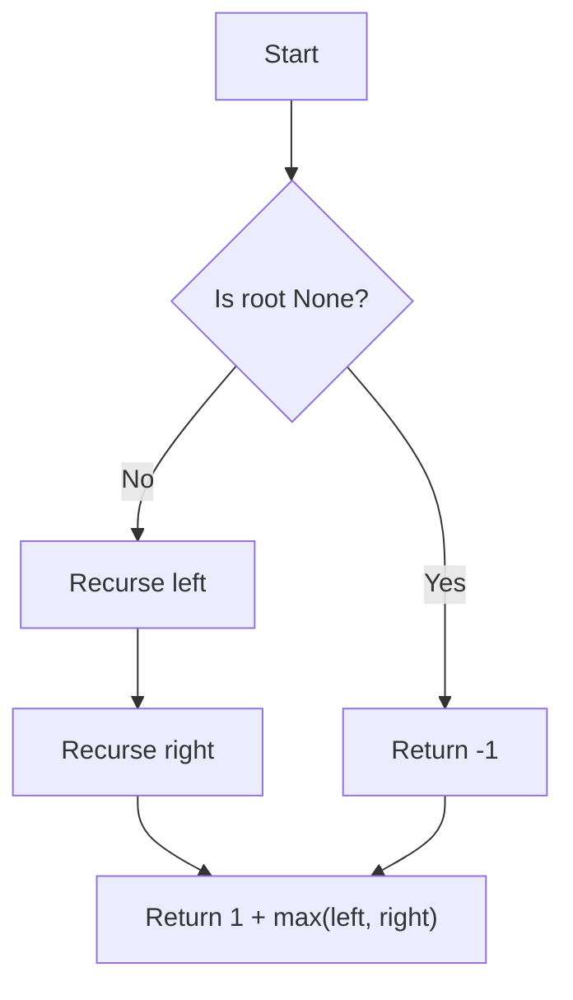

# GFG Height of Binary Tree

Given a binary tree, find its height. The height of a binary tree is the number of edges on the longest path from the root node to a leaf node. If the tree is empty, the height is -1.

## Problem Statement

You are given the root of a binary tree. Write a function `height(root)` that returns the height of the tree.

A **binary tree node** is defined as:

```python
class Node:
    def __init__(self, val):
        self.data = val
        self.left = None
        self.right = None
```

The height of a tree with a single node is 0 (since there are zero edges). An empty tree has height -1.

## Theory

The height of a binary tree can be computed recursively:
- The height of an empty tree is -1.
- The height of a non‑empty tree is 1 + max(height of left subtree, height of right subtree).

This follows directly from the definition: each edge from the root to its child contributes 1 to the height.

## Algorithm

1. If the root is `None`, return -1.
2. Recursively compute the height of the left subtree.
3. Recursively compute the height of the right subtree.
4. Return `1 + max(left_height, right_height)`.

## Complexity Analysis

| Aspect | Complexity |
|--------|------------|
| Time   | **O(N)** – each node is visited once |
| Space  | **O(H)** – recursion stack depth equal to tree height (worst‑case O(N) for a skewed tree) |

## Implementation

```python
class Solution:
    def height(self, root):
        if root is None:
            return -1
        left = self.height(root.left)
        right = self.height(root.right)
        return 1 + max(left, right)
```

## Examples

### Example 1
```
Input:
     1
   /   \
  2     3
 / \   / \
4   5 6   7
Output: 2
```
Explanation: The longest path from root to leaf has 2 edges (e.g., 1->2->4).

### Example 2
```
Input:
     1
      \
       2
        \
         3
Output: 2
```
Explanation: The tree is skewed; the longest path has 2 edges.

### Example 3
```
Input: Empty tree
Output: -1
```

## Running the Tests

The `test.py` file tests the solution with several cases:

- A balanced tree of height 2.
- A skewed tree of height 2.
- A single‑node tree (height 0).
- An empty tree (height -1).

Run tests from the repository root:

```bash
PYTHONPATH=. python BinaryTree/GFG_Height_of_Binary_Tree/test.py
```

Expected output:

```
All GFG_Height_of_Binary_Tree tests passed.
```

## File Structure

```
BinaryTree/
└── GFG_Height_of_Binary_Tree/
    ├── code.py    # Node and Solution implementation
    ├── test.py    # Unit tests
    └── README.md  # Documentation
```

