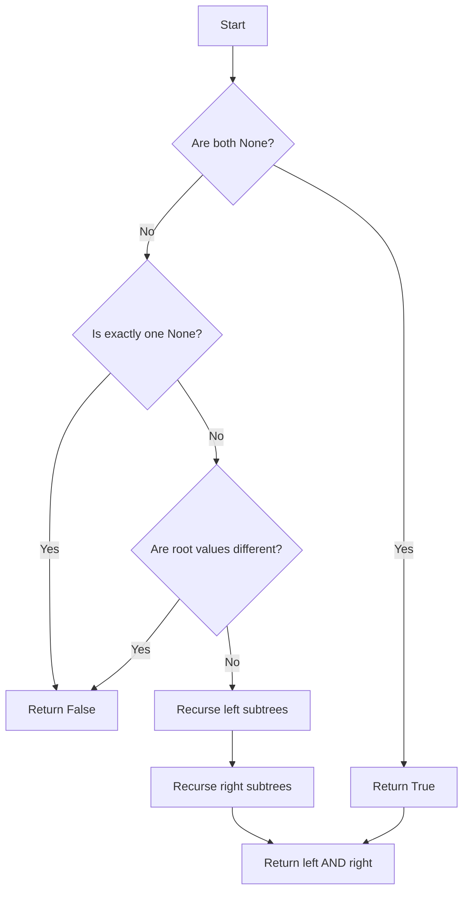

# GFG Identical Trees

Given two binary trees, determine whether they are identical. Two trees are identical if they have the same structure and the same node values.

## Problem Statement

You are given the roots of two binary trees `r1` and `r2`. Write a function `isIdentical(r1, r2)` that returns `True` if the two trees are identical and `False` otherwise.

A **binary tree node** is defined as:

```python
class Node:
    def __init__(self, val):
        self.data = val
        self.left = None
        self.right = None
```

## Theory

Two trees are identical if and only if:
1. Both are empty, OR
2. Both are non-empty, their root values are equal, and their left and right subtrees are identical.

This is a classic recursive problem: compare roots, then recurse on left and right children.

## Algorithm

1. If both `r1` and `r2` are `None`, return `True`.
2. If exactly one is `None`, return `False`.
3. If `r1.data != r2.data`, return `False`.
4. Recursively check `isIdentical(r1.left, r2.left)` and `isIdentical(r1.right, r2.right)`.
5. Return the logical AND of both recursive results.

## Complexity Analysis

| Aspect | Complexity |
|--------|------------|
| Time   | **O(N)** – where N is the number of nodes in the smaller tree (each node visited once) |
| Space  | **O(H)** – recursion stack depth equal to tree height |

## Implementation

```python
'''
# Structure of binary tree node
class Node:
    def __init__(self, val):
        self.data = val
        self.right = None
        self.left = None
'''

class Solution:
    def isIdentical(self, r1, r2):
        if r1 is None and r2 is None:
            return True
        if r1 is None or r2 is None:
            return False
        if r1.data != r2.data:
            return False

        return (self.isIdentical(r1.left, r2.left) and
                self.isIdentical(r1.right, r2.right))
```

## Examples

### Example 1
```
Tree 1:       Tree 2:
     1             1
   /   \         /   \
  2     3       2     3

Output: True
```

### Example 2
```
Tree 1:       Tree 2:
     1             1
   /             /   \
  2             2     3

Output: False
```

### Example 3
```
Tree 1:       Tree 2:
Empty         Empty

Output: True
```

## Running the Tests

Run tests from the repository root:

```bash
PYTHONPATH=. python BinaryTree/GFG_Identical_Trees/test.py
```

Expected output:

```
=== GFG: Identical Trees ===

PASS: isIdentical([1, 2, 3], [1, 2, 3])
  Expected: True
  Got:      True

PASS: isIdentical([1, 2], [1, None, 2])
  Expected: False
  Got:      False

PASS: isIdentical([1, 2, 3], [1, 2])
  Expected: False
  Got:      False

PASS: isIdentical([], [])
  Expected: True
  Got:      True

PASS: isIdentical([1], [1])
  Expected: True
  Got:      True

PASS: isIdentical([1, 2, 3], [1, 3, 2])
  Expected: False
  Got:      False

All GFG_Identical_Trees tests passed.
```

## File Structure

```
BinaryTree/
└── GFG_Identical_Trees/
    ├── code.py    # Node and Solution implementation
    ├── test.py    # Unit tests
    └── README.md  # Documentation
```


