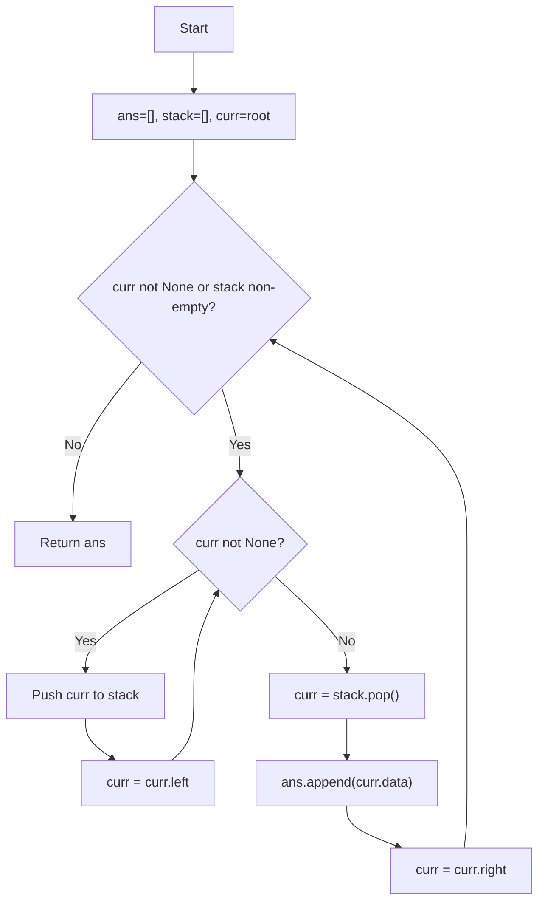

# GFG Iterative Inorder Traversal

Given a binary tree, return its inorder traversal (left, root, right) using an iterative approach (without recursion).

## Problem Statement

You are given the root of a binary tree. Write a function `inOrder(root)` that returns a list of node values in inorder order, implemented iteratively.

A **binary tree node** is defined as:

```python
class Node:
    def __init__(self, val):
        self.data = val
        self.left = None
        self.right = None
```

## Theory

Inorder traversal visits nodes in the order: left subtree, root, right subtree. The iterative version uses an explicit stack to simulate recursion. We push nodes onto the stack while moving left; when we can't go left further, we pop, record the value, and move right.

## Algorithm

1. Initialize `ans = []`, `stack = []`, `curr = root`.
2. While `curr is not None` or `stack` is non-empty:
   a. While `curr` is not `None`:
      - Push `curr` onto `stack`.
      - Move `curr = curr.left`.
   b. Pop `curr` from `stack`.
   c. Append `curr.data` to `ans`.
   d. Move `curr = curr.right`.
3. Return `ans`.

## Complexity Analysis

| Aspect | Complexity |
|--------|------------|
| Time   | **O(N)** – each node visited once |
| Space  | **O(H)** – stack depth equal to tree height |

## Implementation

```python
# Definition for Node
class Node:
    def __init__(self, val):
        self.data = val
        self.left = None
        self.right = None

class Solution:
    def inOrder(self, root):
        ans = []
        stack = []
        curr = root
        while curr is not None or len(stack) > 0:
            while curr is not None:
                stack.append(curr)
                curr = curr.left
            curr = stack.pop()
            ans.append(curr.data)
            curr = curr.right
        return ans
```

## Examples

### Example 1
```
Input:
     1
   /   \
  2     3
 / \   / \
4   5 6   7

Inorder: [4, 2, 5, 1, 6, 3, 7]
```

### Example 2
```
Input:
     1
      \
       2
        \
         3

Inorder: [1, 2, 3]
```

## Running the Tests

Run tests from the repository root:

```bash
PYTHONPATH=. python BinaryTree/GFG_Iterative_Inorder/test.py
```

Expected output:

```
=== GFG: Iterative Inorder ===

PASS: inOrder([1, 2, 3, 4, 5, 6, 7])
  Expected: [4, 2, 5, 1, 6, 3, 7]
  Got:      [4, 2, 5, 1, 6, 3, 7]

PASS: inOrder([1, None, 2, None, 3])
  Expected: [1, 2, 3]
  Got:      [1, 2, 3]

PASS: inOrder([1])
  Expected: [1]
  Got:      [1]

PASS: inOrder([])
  Expected: []
  Got:      []

All GFG_Iterative_Inorder tests passed.
```

## File Structure

```
BinaryTree/
└── GFG_Iterative_Inorder/
    ├── code.py    # Node and Solution implementation
    ├── test.py    # Unit tests
    └── README.md  # Documentation
```


