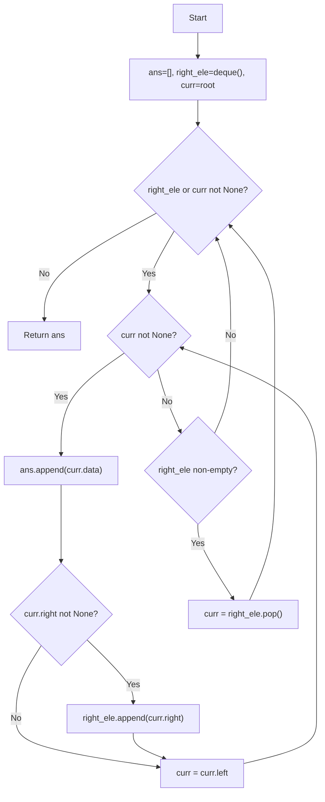

# GFG Iterative Preorder Traversal

Given a binary tree, return its preorder traversal (root, left, right) using an iterative approach (without recursion).

## Problem Statement

You are given the root of a binary tree. Write a function `preOrder(root)` that returns a list of node values in preorder order, implemented iteratively.

A **binary tree node** is defined as:

```python
class Node:
    def __init__(self, val):
        self.data = val
        self.left = None
        self.right = None
```

## Theory

Preorder traversal visits nodes in the order: root, left subtree, right subtree. The iterative version uses a stack (here a deque) to store right children. We process the current node, push its right child onto the stack, then move to the left child. When we reach a `None` left child, we pop a right child from the stack.

## Algorithm

1. Initialize `ans = []`, `right_ele = deque()`, `curr = root`.
2. While `right_ele` is non-empty or `curr` is not `None`:
   a. While `curr` is not `None`:
      - Append `curr.data` to `ans`.
      - If `curr.right` is not `None`, push it onto `right_ele`.
      - Move `curr = curr.left`.
   b. If `right_ele` is non-empty, pop into `curr`.
3. Return `ans`.

## Complexity Analysis

| Aspect | Complexity |
|--------|------------|
| Time   | **O(N)** – each node visited once |
| Space  | **O(H)** – stack depth equal to tree height |

## Implementation

```python
# Binary Tree Node Structure
class Node:
    def __init__(self, val):
        self.data = val
        self.left = None
        self.right = None

class Solution:
    def preOrder(self, root):
        from collections import deque
        ans = []
        right_ele = deque()
        curr = root
        while right_ele or curr is not None:
            while curr is not None:
                ans.append(curr.data)
                if curr.right is not None:
                    right_ele.append(curr.right)
                curr = curr.left

            if right_ele:
                curr = right_ele.pop()
        return ans
```

## Examples

### Example 1
```
Input:
     1
   /   \
  2     3
 / \   / \
4   5 6   7

Preorder: [1, 2, 4, 5, 3, 6, 7]
```

### Example 2
```
Input:
     1
      \
       2
        \
         3

Preorder: [1, 2, 3]
```

## Running the Tests

Run tests from the repository root:

```bash
PYTHONPATH=. python BinaryTree/GFG_Iterative_Preorder/test.py
```

Expected output:

```
=== GFG: Iterative Preorder ===

PASS: preOrder([1, 2, 3, 4, 5, 6, 7])
  Expected: [1, 2, 4, 5, 3, 6, 7]
  Got:      [1, 2, 4, 5, 3, 6, 7]

PASS: preOrder([1, None, 2, None, 3])
  Expected: [1, 2, 3]
  Got:      [1, 2, 3]

PASS: preOrder([1])
  Expected: [1]
  Got:      [1]

PASS: preOrder([])
  Expected: []
  Got:      []

All GFG_Iterative_Preorder tests passed.
```

## File Structure

```
BinaryTree/
└── GFG_Iterative_Preorder/
    ├── code.py    # Node and Solution implementation
    ├── test.py    # Unit tests
    └── README.md  # Documentation
```


