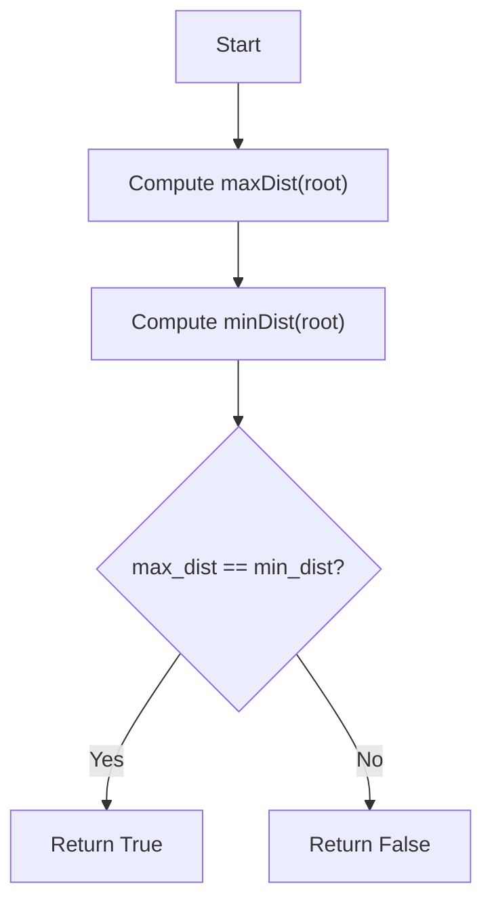

# GFG Leaves at Same Level or Not

Given a binary tree, determine whether all leaf nodes are at the same level.

## Problem Statement

You are given the root of a binary tree. Write a function `check(root)` that returns `True` if all leaves are at the same level and `False` otherwise.

A **binary tree node** is defined as:

```python
class Node:
    def __init__(self, val):
        self.data = val
        self.left = None
        self.right = None
```

## Theory

If all leaves are at the same level, then the minimum leaf depth equals the maximum leaf depth. We can compute both via DFS:
- `minDist(node)`: shortest distance to a leaf (preferring single-child paths).
- `maxDist(node)`: longest distance to a leaf.

If they are equal, all leaves are at the same level.

## Algorithm

1. Define `minDist(curr)` returning the minimum leaf depth.
2. Define `maxDist(curr)` returning the maximum leaf depth.
3. `max_dist = maxDist(root)`, `min_dist = minDist(root)`.
4. Return `max_dist == min_dist`.

## Complexity Analysis

| Aspect | Complexity |
|--------|------------|
| Time   | **O(N^2)** in worst case (minDist recomputes) – but acceptable for small trees |
| Space  | **O(H)** – recursion stack depth |

## Implementation

```python
# Definition for Node
class Node:
    def __init__(self, val):
        self.data = val
        self.left = None
        self.right = None

class Solution:
    def check(self, root):
        def minDist(curr):
            if curr is None:
                return 0

            if curr.left is None:
                return 1 + minDist(curr.right)

            if curr.right is None:
                return 1 + minDist(curr.left)

            return 1 + min(
                minDist(curr.left),
                minDist(curr.right)
            )

        def maxDist(curr):
            if curr is None:
                return 0

            return 1 + max(
                maxDist(curr.left),
                maxDist(curr.right)
            )

        max_dist = maxDist(root)
        min_dist = minDist(root)

        return max_dist == min_dist
```

## Examples

### Example 1
```
Input:
     1
   /   \
  2     3

Leaves 2 and 3 at level 1 → same level.
Output: True
```

### Example 2
```
Input:
     1
   /   \
  2     3
 /
4

Leaves 4 (level 2) and 3 (level 1) → not same.
Output: False
```

## Running the Tests

Run tests from the repository root:

```bash
PYTHONPATH=. python BinaryTree/GFG_Leaves_at_Same_Level/test.py
```

Expected output:

```
=== GFG: Leaves at Same Level or Not ===

PASS: check([1, 2, 3])
  Expected: True
  Got:      True

PASS: check([1, 2, 3, 4, 5, 6, 7])
  Expected: True
  Got:      True

PASS: check([1, 2, 3, 4, None, 5, 6])
  Expected: True
  Got:      True

PASS: check([1, 2, 3, 4, 5, 6, 7, 8])
  Expected: False
  Got:      False

PASS: check([1])
  Expected: True
  Got:      True

PASS: check([])
  Expected: True
  Got:      True

All GFG_Leaves_at_Same_Level tests passed.
```

## File Structure

```
BinaryTree/
└── GFG_Leaves_at_Same_Level/
    ├── code.py    # Node and Solution implementation
    ├── test.py    # Unit tests
    └── README.md  # Documentation
```


