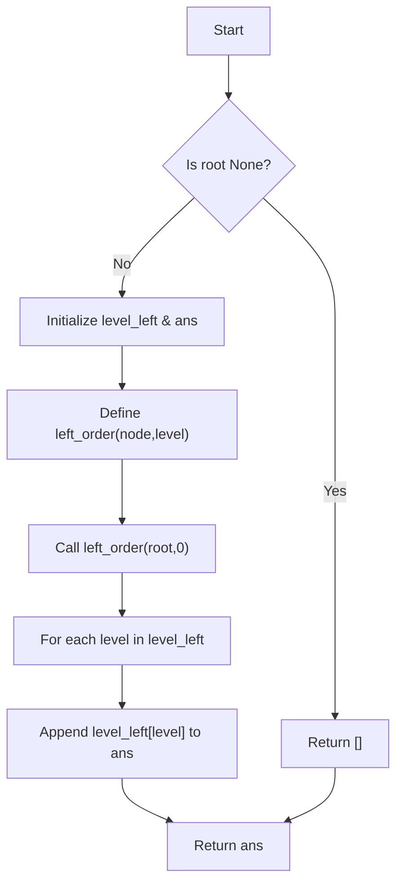

# GFG Left View of Binary Tree

Given a binary tree, return the left view of the tree. The left view contains the first node visible at each level when viewed from the left side.

## Problem Statement

You are given the root of a binary tree. Write a function `leftView(root)` that returns a list of node values representing the left view of the tree (one node per level, from top to bottom).

A **binary tree node** is defined as:

```python
class Node:
    def __init__(self, val):
        self.data = val
        self.left = None
        self.right = None
```

## Theory

The left view of a binary tree is the set of nodes visible when the tree is viewed from the left side. At each level, the leftmost node is visible. We can find this using a preorder traversal (root, left, right) and recording the first node encountered at each depth.

We maintain a dictionary `level_left` where:
- `level_left[level]` stores the data of the first node visited at that level.

Because preorder visits left before right, the first node recorded at each level is the leftmost node.

## Algorithm

1. If the tree is empty (`root` is `None`), return an empty list.
2. Initialize `level_left` as an empty dictionary and `ans` as an empty list.
3. Define a recursive helper `left_order(node, level)`:
   a. If `node` is `None`, return.
   b. If `level` not in `level_left`, set `level_left[level] = node.data`.
   c. Recursively call `left_order(node.left, level + 1)`.
   d. Recursively call `left_order(node.right, level + 1)`.
4. Call `left_order(root, 0)`.
5. For each `level` in `level_left` (in order), append `level_left[level]` to `ans`.
6. Return `ans`.

## Complexity Analysis

| Aspect | Complexity |
|--------|------------|
| Time   | **O(N)** – each node visited once |
| Space  | **O(H)** – recursion stack depth (worst case O(N) for skewed tree) |

## Implementation

```python
'''
# Structure of binary tree node
class Node:
    def __init__(self, val):
        self.data = val
        self.left = None
        self.right = None
'''

class Solution:
    def leftView(self, root):
        level_left = {}
        ans = []

        def left_order(root, level):
            if root is None:
                return
            if level not in level_left:
                level_left[level] = root.data
            left_order(root.left, level + 1)
            left_order(root.right, level + 1)

        left_order(root, 0)

        for level in level_left:
            ans.append(level_left[level])
        return ans
```

## Examples

### Example 1
```
Input:
     1
   /   \
  2     3
 / \   / \
4   5 6   7

Left view: [1, 2, 4]
```

### Example 2
```
Input:
     1
   /   \
  2     3
       / \
      4   5

Left view: [1, 2, 4]
```

### Example 3
```
Input: Empty tree

Output: []
```

## Running the Tests

Run tests from the repository root:

```bash
PYTHONPATH=. python BinaryTree/GFG_Left_View_of_Binary_Tree/test.py
```

Expected output:

```
=== GFG: Left View of Binary Tree ===

PASS: leftView([1, 2, 3, 4, 5, 6, 7])
  Expected: [1, 2, 4]
  Got:      [1, 2, 4]

PASS: leftView([1, 2, 3, None, None, 4, 5])
  Expected: [1, 2, 4]
  Got:      [1, 2, 4]

PASS: leftView([1])
  Expected: [1]
  Got:      [1]

PASS: leftView([])
  Expected: []
  Got:      []

All GFG_Left_View_of_Binary_Tree tests passed.
```

## File Structure

```
BinaryTree/
└── GFG_Left_View_of_Binary_Tree/
    ├── code.py    # Node and Solution implementation
    ├── test.py    # Unit tests
    └── README.md  # Documentation
```


