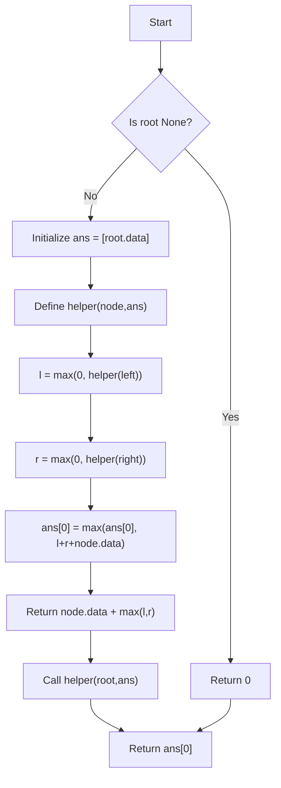

# GFG Maximum Path Sum

Given a binary tree, find the maximum path sum. A path is any sequence of nodes where each pair of adjacent nodes has an edge, and a node can appear at most once. The path does not need to pass through the root.

## Problem Statement

You are given the root of a binary tree. Write a function `findMaxSum(root)` that returns the maximum path sum in the tree.

A **binary tree node** is defined as:

```python
class Node:
    def __init__(self, val):
        self.data = val
        self.left = None
        self.right = None
```

## Theory

For each node, the maximum path sum that passes through it is `node.data + max(0, left_gain) + max(0, right_gain)`, where `left_gain` and `right_gain` are the maximum path sums starting from the left/right child going downward. We use `max(0, ...)` to ignore negative contributions. We track the global maximum across all nodes.

The helper returns `node.data + max(left_gain, right_gain)` — the best path sum starting at this node going downward (for parent to use).

## Algorithm

1. If `root` is `None`, return 0.
2. Initialize `ans = [root.data]`.
3. Define a recursive helper `helper(node, ans)`:
   a. If `node` is `None`, return 0.
   b. `l = max(0, helper(node.left, ans))`.
   c. `r = max(0, helper(node.right, ans))`.
   d. `ans[0] = max(ans[0], l + r + node.data)`.
   e. Return `node.data + max(l, r)`.
4. Call `helper(root, ans)`.
5. Return `ans[0]`.

## Complexity Analysis

| Aspect | Complexity |
|--------|------------|
| Time   | **O(N)** – each node visited once |
| Space  | **O(H)** – recursion stack depth |

## Implementation

```python
'''
# Structure of binary tree node
class Node:
    def __init__(self, val):
        self.data = val
        self.left = None
        self.right = None
'''

class Solution:
    def findMaxSum(self, root):
        if root is None:
            return 0

        ans = [root.data]

        def helper(root, ans):
            if root is None:
                return 0
            l = max(0, helper(root.left, ans))
            r = max(0, helper(root.right, ans))
            ans[0] = max(ans[0], l + r + root.data)
            return root.data + max(l, r)

        helper(root, ans)

        return ans[0]
```

## Examples

### Example 1
```
Input:
     10
   /    \
  2      10
 / \       \
20   1     -25
            /  \
           3    4

Path: 20 -> 2 -> 10 -> 10 = 42
Output: 42
```

### Example 2
```
Input:
    -10
   /    \
  9      20
        /  \
       15   7

Path: 15 -> 20 -> 7 = 42
Output: 42
```

## Running the Tests

Run tests from the repository root:

```bash
PYTHONPATH=. python BinaryTree/GFG_Maximum_Path_Sum/test.py
```

Expected output:

```
=== GFG: Maximum Path Sum ===

PASS: findMaxSum([10, 2, 10, 20, 1, None, -25, None, None, None, None, 3, 4])
  Expected: 42
  Got:      42

PASS: findMaxSum([-10, 9, 20, None, None, 15, 7])
  Expected: 42
  Got:      42

PASS: findMaxSum([1])
  Expected: 1
  Got:      1

PASS: findMaxSum([-3])
  Expected: -3
  Got:      -3

PASS: findMaxSum([1, -2, 3])
  Expected: 4
  Got:      4

All GFG_Maximum_Path_Sum tests passed.
```

## File Structure

```
BinaryTree/
└── GFG_Maximum_Path_Sum/
    ├── code.py    # Node and Solution implementation
    ├── test.py    # Unit tests
    └── README.md  # Documentation
```


