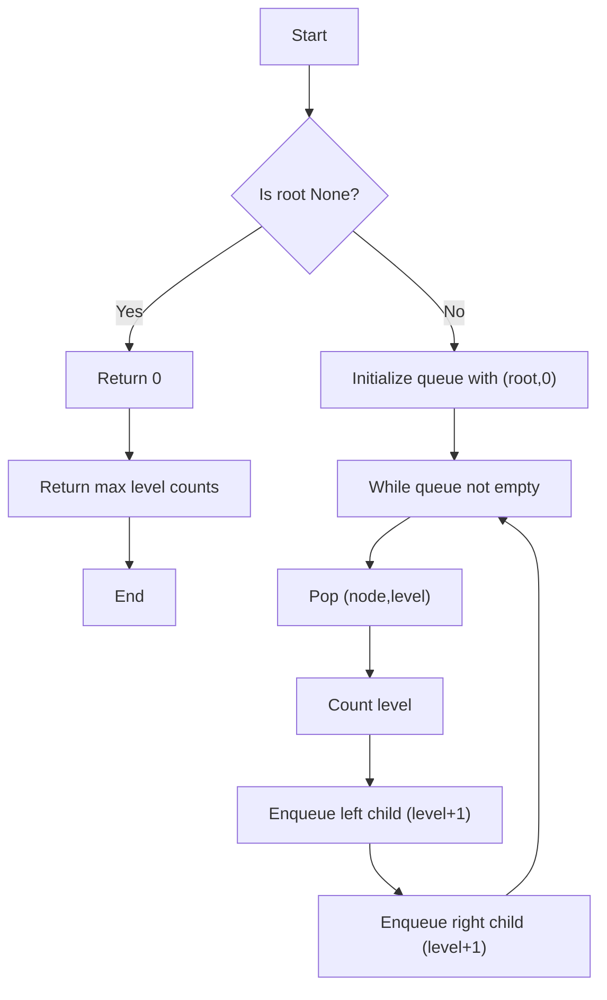

# GFG Maximum Width of Binary Tree

Given a binary tree, return the maximum width (the number of nodes) at any level of the tree.

## Problem Statement

You are given the root of a binary tree. Write a function `maxWidth(root)` that returns the maximum number of nodes present at any single level (depth) of the tree.

A **binary tree node** is defined as:

```python
class Node:
    def __init__(self, val):
        self.data = val
        self.left = None
        self.right = None
```

The width of a level is simply the count of nodes that exist at that depth.

## Theory

To find the maximum width of a binary tree, we need to count the number of nodes at each level and return the largest count. This can be achieved using breadth‑first search (BFS), which processes nodes level by level. At each level, we increment a counter for the number of nodes encountered, then move to the next level.

The maximum width can be found using BFS:
- Initialize a queue with the root node and level 0.
- While the queue is not empty:
  - Process all nodes at the current level and count them.
  - Enqueue their children with level+1.
- Keep track of the maximum count observed across all levels.

## Algorithm

1. If the tree is empty (`root` is `None`), return 0.
2. Initialize a queue (list or `collections.deque`) with a tuple `(root, 0)`.
3. Initialize `level_counts` as an empty dictionary to count nodes per level.
4. While the queue is not empty:
   a. Pop the first `(node, level)` from the queue.
   b. Increment `level_counts[level]` by 1.
   c. If `node.left` exists, append `(node.left, level+1)` to the queue.
   d. If `node.right` exists, append `(node.right, level+1)` to the queue.
5. Return the maximum value in `level_counts`.

## Complexity Analysis

| Aspect  | Complexity |
|---------|------------|
| Time    | **O(N)** – each node is visited exactly once |
| Space   | **O(N)** – queue can hold up to `N` nodes in the worst case (e.g., for a complete binary tree) |

## Implementation

```python
"""
# Structure of Binary Tree Node
class Node:
    def __init__(self, val):
        self.data = val
        self.left = None
        self.right = None
"""

class Solution:
    def maxWidth(self, root):
        if not root:
            return 0
        
        queue = [(root, 0)]
        level_counts = {}
        
        while queue:
            node, level = queue.pop(0)
            level_counts[level] = level_counts.get(level, 0) + 1
            if node.left:
                queue.append((node.left, level + 1))
            if node.right:
                queue.append((node.right, level + 1))
        
        return max(level_counts.values())
```

## Examples

### Example 1
```
Input:
     1
   /   \
  2     3
 / \   / \
4   5 6   7

Level widths:
Level 0: 1 node (1)
Level 1: 2 nodes (2, 3)
Level 2: 4 nodes (4, 5, 6, 7)

Output: 4
```

### Example 2
```
Input:
     1
   /   \
  2     3
       /
      4
       \
        5
       /
      6

Level widths:
Level 0: 1 node (1)
Level 1: 2 nodes (2, 3)
Level 2: 2 nodes (4, 5)
Level 3: 1 node (6)

Output: 2
```

### Example 3
```
Input:
Empty tree

Output: 0
```

## Running the Tests

The `test.py` file tests the solution with several cases:

- A balanced tree with maximum width of 4 nodes.
- A skewed tree where width varies.
- An empty tree.

Run tests from the repository root:

```bash
PYTHONPATH=. python BinaryTree/GFG_Maximum_Width_of_Tree/test.py
```

Expected output:

```
=== GFG: Maximum Width of Binary Tree ===

PASS: maxWidth([1, 3, 2])
  Expected: 2
  Got:      2

PASS: maxWidth([1, 3, 2, 5, 3, None, 9])
  Expected: 4
  Got:      4

PASS: maxWidth([1, 2, 3, 4, 5, 6, 7, 8, 9, None, None, 12, None, None, 15])
  Expected: 5
  Got:      5

PASS: maxWidth([])
  Expected: 0
  Got:      0

All GFG_Maximum_Width_of_Tree tests passed.
```

## File Structure

```
BinaryTree/
└── GFG_Maximum_Width_of_Tree/
    ├── code.py    # Node and Solution implementation
    ├── test.py    # Unit tests
    └── README.md  # Documentation
```


