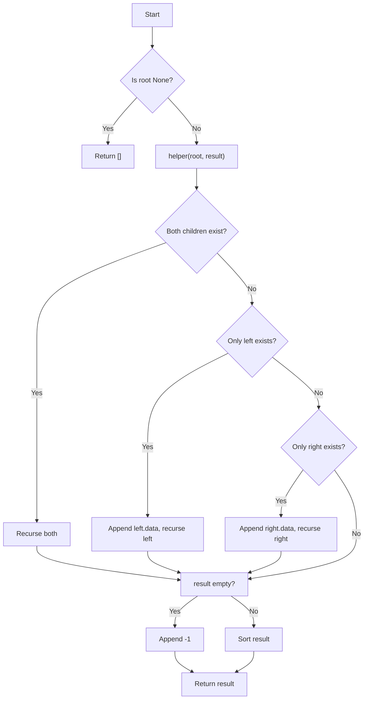

# GFG Nodes Without Sibling

Given a binary tree, print all nodes that do not have a sibling. A node has no sibling if it is the only child of its parent (i.e., the parent has only one child). Return the values in sorted order; if none, return [-1].

## Problem Statement

You are given the root of a binary tree. Write a function `noSibling(root)` that returns a list of node values that have no sibling, sorted in ascending order. If no such node exists, return [-1].

A **binary tree node** is defined as:

```python
class Node:
    def __init__(self, val):
        self.data = val
        self.left = None
        self.right = None
```

## Theory

A node has no sibling if its parent has only one child. We can detect this during a DFS: at each node, if it has exactly one child, that child's value is added to the result. We then recurse on whichever child exists.

## Algorithm

1. Initialize `result = []`.
2. Define a recursive helper `helper(node, result)`:
   a. If `node` is `None`, return.
   b. If both children exist, recurse on both.
   c. If only left child exists, append `node.left.data` to `result` and recurse left.
   d. If only right child exists, append `node.right.data` to `result` and recurse right.
3. Call `helper(root, result)`.
4. If `result` is empty, append `-1`; otherwise sort it.
5. Return `result`.

## Complexity Analysis

| Aspect | Complexity |
|--------|------------|
| Time   | **O(N log N)** – traversal O(N) plus sort |
| Space  | **O(H)** – recursion stack depth |

## Implementation

```python
# Definition for Node
class Node:
    def __init__(self, val):
        self.data = val
        self.left = None
        self.right = None

class Solution:
    def noSibling(self, root):
        result = []

        def helper(root, result):
            if root is None:
                return
            if root.left and root.right:
                helper(root.left, result)
                helper(root.right, result)
            elif root.left:
                result.append(root.left.data)
                helper(root.left, result)
            elif root.right:
                result.append(root.right.data)
                helper(root.right, result)

        helper(root, result)

        if not result:
            result.append(-1)
        else:
            result.sort()

        return result
```

## Examples

### Example 1
```
Input:
     1
   /   \
  2     3

Both children have siblings → no node without sibling.
Output: [-1]
```

### Example 2
```
Input:
     1
   /   \
  2     3
 /
4

Node 4 has no sibling (2 has only left child).
Output: [4]
```

### Example 3
```
Input:
     1
   /
  2
 /
4

Nodes 2 and 4 each have no sibling.
Output: [2, 4]
```

## Running the Tests

Run tests from the repository root:

```bash
PYTHONPATH=. python BinaryTree/GFG_Nodes_Without_Sibling/test.py
```

Expected output:

```
=== GFG: Nodes Without Sibling ===

PASS: noSibling([1, 2, 3])
  Expected: [-1]
  Got:      [-1]

PASS: noSibling([1, 2, 3, 4, None, 5, 6])
  Expected: [4]
  Got:      [4]

PASS: noSibling([1])
  Expected: [-1]
  Got:      [-1]

PASS: noSibling([])
  Expected: [-1]
  Got:      [-1]

PASS: noSibling([1, 2, None, 4])
  Expected: [2, 4]
  Got:      [2, 4]

All GFG_Nodes_Without_Sibling tests passed.
```

## File Structure

```
BinaryTree/
└── GFG_Nodes_Without_Sibling/
    ├── code.py    # Node and Solution implementation
    ├── test.py    # Unit tests
    └── README.md  # Documentation
```


