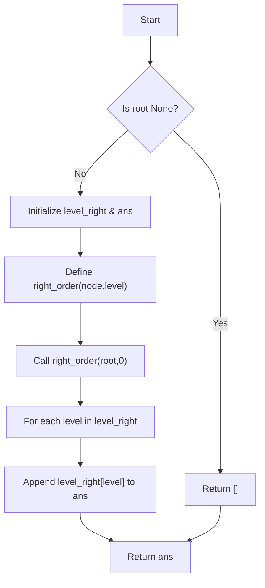

# GFG Right View of Binary Tree

Given a binary tree, return the right view of the tree. The right view contains the last node visible at each level when viewed from the right side.

## Problem Statement

You are given the root of a binary tree. Write a function `rightView(root)` that returns a list of node values representing the right view of the tree (one node per level, from top to bottom).

A **binary tree node** is defined as:

```python
class Node:
    def __init__(self, val):
        self.data = val
        self.left = None
        self.right = None
```

## Theory

The right view of a binary tree is the set of nodes visible when the tree is viewed from the right side. At each level, the rightmost node is visible. We can find this using a modified preorder traversal (root, right, left) and recording the first node encountered at each depth.

We maintain a dictionary `level_right` where:
- `level_right[level]` stores the data of the first node visited at that level.

Because we visit the right child before the left child, the first node recorded at each level is the rightmost node.

## Algorithm

1. If the tree is empty (`root` is `None`), return an empty list.
2. Initialize `level_right` as an empty dictionary and `ans` as an empty list.
3. Define a recursive helper `right_order(node, level)`:
   a. If `node` is `None`, return.
   b. If `level` not in `level_right`, set `level_right[level] = node.data`.
   c. Recursively call `right_order(node.right, level + 1)`.
   d. Recursively call `right_order(node.left, level + 1)`.
4. Call `right_order(root, 0)`.
5. For each `level` in `level_right` (in order), append `level_right[level]` to `ans`.
6. Return `ans`.

## Complexity Analysis

| Aspect | Complexity |
|--------|------------|
| Time   | **O(N)** – each node visited once |
| Space  | **O(H)** – recursion stack depth (worst case O(N) for skewed tree) |

## Implementation

```python
'''
# Structure of binary tree node
class Node:
    def __init__(self, val):
        self.data = val
        self.left = None
        self.right = None
'''

class Solution:
    def rightView(self, root):
        level_right = {}
        ans = []

        def right_order(root, level):
            if root is None:
                return
            if level not in level_right:
                level_right[level] = root.data

            right_order(root.right, level + 1)
            right_order(root.left, level + 1)

        right_order(root, 0)

        for level in level_right:
            ans.append(level_right[level])

        return ans
```

## Examples

### Example 1
```
Input:
     1
   /   \
  2     3
 / \   / \
4   5 6   7

Right view: [1, 3, 7]
```

### Example 2
```
Input:
     1
   /   \
  2     3
 / \
4   5

Right view: [1, 3, 5]
```

### Example 3
```
Input: Empty tree

Output: []
```

## Running the Tests

Run tests from the repository root:

```bash
PYTHONPATH=. python BinaryTree/GFG_Right_View_of_Binary_Tree/test.py
```

Expected output:

```
=== GFG: Right View of Binary Tree ===

PASS: rightView([1, 2, 3, 4, 5, 6, 7])
  Expected: [1, 3, 7]
  Got:      [1, 3, 7]

PASS: rightView([1, 2, 3, None, None, 4, 5])
  Expected: [1, 3, 5]
  Got:      [1, 3, 5]

PASS: rightView([1])
  Expected: [1]
  Got:      [1]

PASS: rightView([])
  Expected: []
  Got:      []

All GFG_Right_View_of_Binary_Tree tests passed.
```

## File Structure

```
BinaryTree/
└── GFG_Right_View_of_Binary_Tree/
    ├── code.py    # Node and Solution implementation
    ├── test.py    # Unit tests
    └── README.md  # Documentation
```


