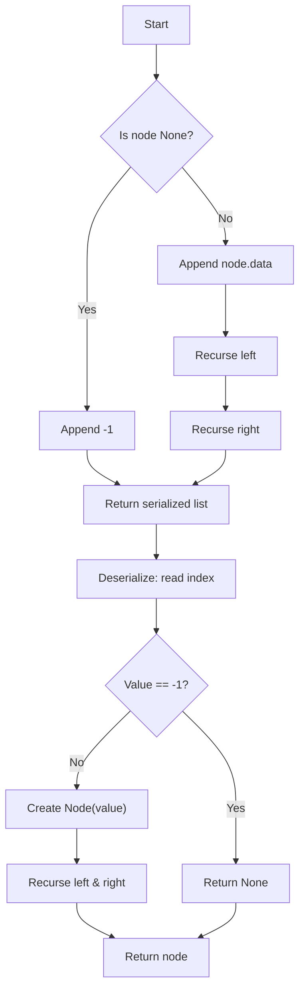

# GFG Serialize and Deserialize a Binary Tree

Given a binary tree, serialize it into an array and deserialize the array back into the original tree.

## Problem Statement

You are given the root of a binary tree. Write two functions:
- `serialize(root)` that converts the tree into a list of integers.
- `deSerialize(arr)` that reconstructs the tree from the list.

A **binary tree node** is defined as:

```python
class Node:
    def __init__(self, val=0):
        self.data = val
        self.left = None
        self.right = None
```

We use `-1` to represent `None` (null) nodes.

## Theory

We can serialize the tree using **preorder traversal**. For each node, we append its value; for `None`, we append `-1`. This produces a unique representation that can be deserialized by reading values in the same preorder order.

Deserialization reads the list sequentially: if the current value is `-1`, return `None`; otherwise create a node with that value and recursively build left and right subtrees.

## Algorithm

### Serialize
1. Initialize an empty list `ans`.
2. Define a recursive helper `dfs(node)`:
   a. If `node` is `None`, append `-1` and return.
   b. Append `node.data`.
   c. Recurse on `node.left`.
   d. Recurse on `node.right`.
3. Call `dfs(root)`.
4. Return `ans`.

### Deserialize
1. Use an index pointer `i` (wrapped in a list for mutability).
2. Define a recursive helper `dfs()`:
   a. If `i >= len(arr)`, return `None`.
   b. If `arr[i] == -1`, increment `i` and return `None`.
   c. Create `Node(arr[i])`, increment `i`.
   d. Set `node.left = dfs()`.
   e. Set `node.right = dfs()`.
   f. Return `node`.
3. Return `dfs()`.

## Complexity Analysis

| Aspect | Complexity |
|--------|------------|
| Time   | **O(N)** – each node visited once |
| Space  | **O(N)** – serialized list and recursion stack |

## Implementation

```python
# Structure of binary tree node
class Node:
    def __init__(self, val=0):
        self.data = val
        self.left = None
        self.right = None

class Solution:
    def serialize(self, root):
        ans = []

        def dfs(root):
            if root is None:
                ans.append(-1)
                return
            ans.append(root.data)
            dfs(root.left)
            dfs(root.right)

        dfs(root)
        return ans

    def deSerialize(self, arr):
        i = [0]

        def dfs():
            if i[0] >= len(arr):
                return None
            if arr[i[0]] == -1:
                i[0] += 1
                return None
            root = Node(arr[i[0]])
            i[0] += 1
            root.left = dfs()
            root.right = dfs()
            return root

        return dfs()
```

## Examples

### Example 1
```
Input:
     1
   /   \
  2     3

Serialized: [1, 2, -1, -1, 3, -1, -1]
Deserialized: same tree
```

### Example 2
```
Input: Empty tree

Serialized: [-1]
Deserialized: None
```

## Running the Tests

Run tests from the repository root:

```bash
PYTHONPATH=. python BinaryTree/GFG_Serialize_and_Deserialize_Binary_Tree/test.py
```

Expected output:

```
=== GFG: Serialize and Deserialize a Binary Tree ===

PASS: serialize/deserialize([1, 2, 3])
  Serialized:   [1, 2, -1, -1, 3, -1, -1]
  Deserialized: [1, 2, 3]

PASS: serialize/deserialize([1, 2, 3, 4, 5, 6, 7])
  Serialized:   [1, 2, 4, -1, -1, 5, -1, -1, 3, 6, -1, -1, 7, -1, -1]
  Deserialized: [1, 2, 3, 4, 5, 6, 7]

PASS: serialize/deserialize([1])
  Serialized:   [1, -1, -1]
  Deserialized: [1]

PASS: serialize/deserialize([])
  Serialized:   [-1]
  Deserialized: []

PASS: serialize/deserialize([1, None, 2])
  Serialized:   [1, -1, 2, -1, -1]
  Deserialized: [1, None, 2]

All GFG_Serialize_and_Deserialize_Binary_Tree tests passed.
```

## File Structure

```
BinaryTree/
└── GFG_Serialize_and_Deserialize_Binary_Tree/
    ├── code.py    # Node and Solution implementation
    ├── test.py    # Unit tests
    └── README.md  # Documentation
```


