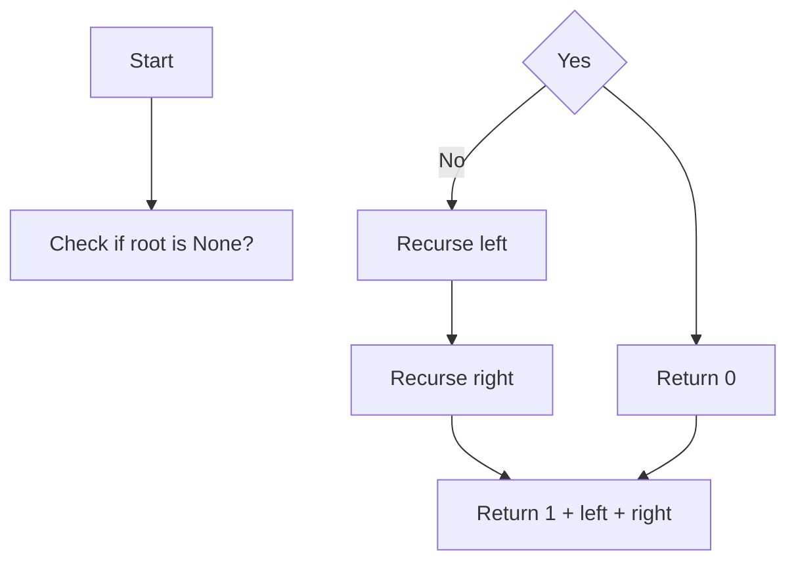

# GFG Size of Binary Tree

Given a binary tree, return the total number of nodes present in the tree.

## Problem Statement

The function `getSize(root)` should return the number of nodes in the binary tree rooted at `root`. A node may have zero, one, or two children.

## Theory

The size of a binary tree can be computed recursively: the size of the tree rooted at a node is 1 (the node itself) plus the sizes of its left and right sub‑trees. The base case is an empty tree (root is `None`), whose size is 0.

## Algorithm

1. If the current node is `None`, return 0.
2. Recursively compute the size of the left sub‑tree.
3. Recursively compute the size of the right sub‑tree.
4. Return `1 + left_size + right_size`.

## Complexity Analysis

| Aspect | Complexity |
|--------|------------|
| Time   | **O(N)** – each node is visited once |
| Space  | **O(H)** – recursion stack depth equal to tree height (worst‑case O(N) for a skewed tree) |

## Implementation

```python
class Node:
    def __init__(self, val):
        self.data = val
        self.left = None
        self.right = None

class Solution:
    def getSize(self, root):
        if root is None:
            return 0
        left = self.getSize(root.left)
        right = self.getSize(root.right)
        return 1 + left + right
```

## Examples

### Example 1
```
Input:
     1
   / \
  2   3
Output: 3
```

### Example 2
```
Input:
     1
      \
       2
        \
         3
Output: 3
```

### Example 3
```
Input:
Empty tree
Output: 0
```

## Running the Tests

The `test.py` file tests the solution with several cases:

- A tree with three nodes.
- A skewed tree of three nodes.
- An empty tree.

Run tests from the repository root:

```bash
PYTHONPATH=. python BinaryTree/GFG_Size_of_Binary_Tree/test.py
```

Expected output:

```
All GFG_Size_of_Binary_Tree tests passed.
```

## File Structure

```
BinaryTree/
└── GFG_Size_of_Binary_Tree/
    ├── code.py    # Node and Solution implementation
    ├── test.py    # Unit tests
    └── README.md  # Documentation
```

