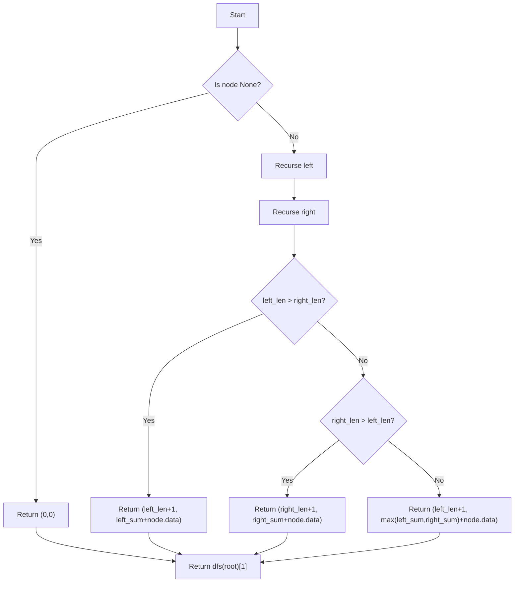

# GFG Sum of Nodes on the Longest Path

Given a binary tree, find the sum of nodes on the longest path from root to a leaf. If there are multiple longest paths, return the maximum sum among them.

## Problem Statement

You are given the root of a binary tree. Write a function `sumOfLongRootToLeafPath(root)` that returns the sum of nodes on the longest root-to-leaf path. In case of a tie in path length, return the maximum sum.

A **binary tree node** is defined as:

```python
class Node:
    def __init__(self, val):
        self.data = val
        self.left = None
        self.right = None
```

## Theory

We can solve this with a post-order DFS. For each node, we compute two values for its subtree:
- `length`: the number of nodes on the longest path from this node to a leaf.
- `sum`: the sum of nodes on that longest path (with tie-break by maximum sum).

For a node:
- If it's `None`, return `(0, 0)`.
- Recursively get `(left_len, left_sum)` and `(right_len, right_sum)`.
- If `left_len > right_len`: the longest path goes left → return `(left_len + 1, left_sum + node.data)`.
- If `right_len > left_len`: the longest path goes right → return `(right_len + 1, right_sum + node.data)`.
- If equal: tie-break by max sum → return `(left_len + 1, max(left_sum, right_sum) + node.data)`.

## Algorithm

1. Define a recursive helper `dfs(node)` returning `(length, sum)`.
2. If `node` is `None`, return `(0, 0)`.
3. Recurse on left and right children.
4. Compare lengths and return accordingly (tie-break by max sum).
5. Return `dfs(root)[1]`.

## Complexity Analysis

| Aspect | Complexity |
|--------|------------|
| Time   | **O(N)** – each node visited once |
| Space  | **O(H)** – recursion stack depth |

## Implementation

```python
# Definition for Node
class Node:
    def __init__(self, val):
        self.data = val
        self.left = None
        self.right = None

class Solution:
    def sumOfLongRootToLeafPath(self, root: 'Node') -> int:
        def dfs(root):
            if not root:
                return (0, 0)

            left_len, left_sum = dfs(root.left)
            right_len, right_sum = dfs(root.right)

            if left_len > right_len:
                return (left_len + 1, left_sum + root.data)
            elif right_len > left_len:
                return (right_len + 1, right_sum + root.data)
            else:
                return (left_len + 1, max(left_sum, right_sum) + root.data)

        return dfs(root)[1]
```

## Examples

### Example 1
```
Input:
     4
   /   \
  2     5
 / \   / \
7   1 2   3
    /
   6

Longest path: 4 -> 2 -> 1 -> 6 (length 4), sum = 13
Output: 13
```

### Example 2
```
Input:
     4
   /   \
  2     5
 / \   / \
7   1 2   3

Longest paths all have length 3; max sum = 4+2+7 = 13
Output: 13
```

## Running the Tests

Run tests from the repository root:

```bash
PYTHONPATH=. python BinaryTree/GFG_Sum_Nodes_on_Longest_Path/test.py
```

Expected output:

```
=== GFG: Sum Nodes on Longest Path ===

PASS: sumOfLongRootToLeafPath([4, 2, 5, 7, 1, 2, 3, None, None, 6])
  Expected: 13
  Got:      13

PASS: sumOfLongRootToLeafPath([4, 2, 5, 7, 1, 2, 3])
  Expected: 13
  Got:      13

PASS: sumOfLongRootToLeafPath([1])
  Expected: 1
  Got:      1

PASS: sumOfLongRootToLeafPath([])
  Expected: 0
  Got:      0

All GFG_Sum_Nodes_on_Longest_Path tests passed.
```

## File Structure

```
BinaryTree/
└── GFG_Sum_Nodes_on_Longest_Path/
    ├── code.py    # Node and Solution implementation
    ├── test.py    # Unit tests
    └── README.md  # Documentation
```


